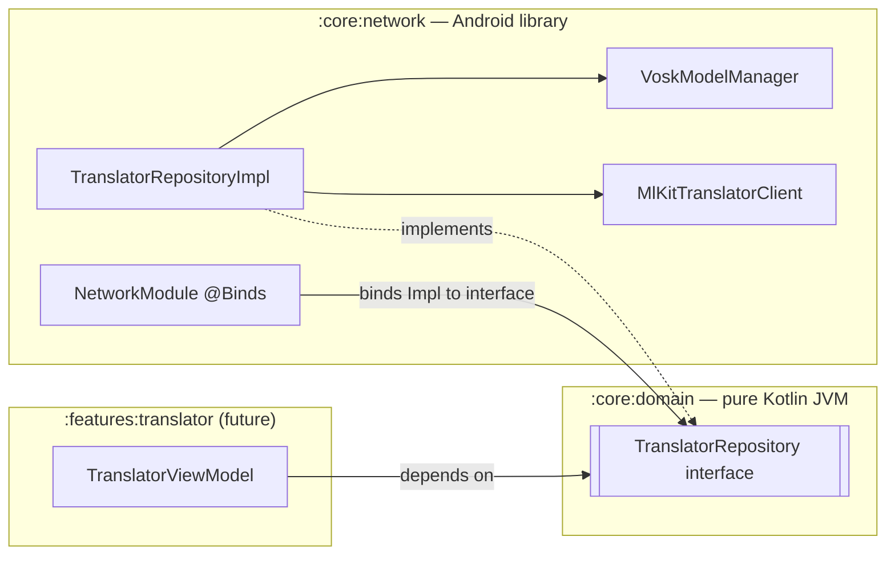
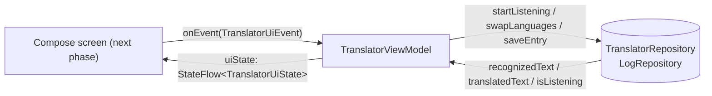
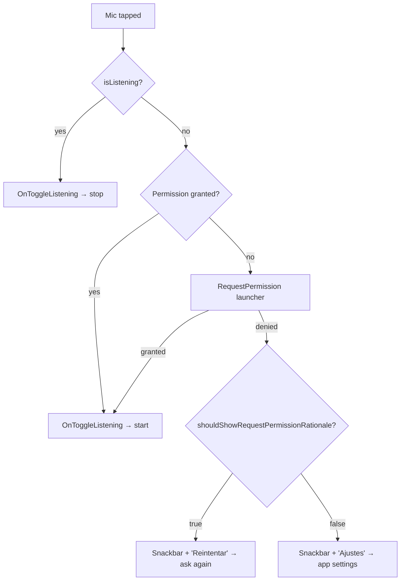

# DEV_LOG — Offline Speech & Translation Data Layer

**Module:** `:core:network` · **Scope:** Dev A (ML & Hardware) · **Date:** 2026-10-05

This entry documents the offline speech-to-text (Vosk) and on-device translation (Google ML Kit)
implementation behind the domain contract `TranslatorRepository`.

---

## 1. Architectural Flow

### 1.1 Dependency direction



- **`:core:domain` stays pure Kotlin.** It only declares `TranslatorRepository` with
  `StateFlow<String>`, `StateFlow<Boolean>` and `Result<Unit>`. No Vosk, ML Kit or `android.*`
  type appears in the contract, so the domain module still compiles as a plain `java-library`.
- **All infrastructure lives in `:core:network`.** Vosk, JNA, ML Kit, `AudioRecord`, `Context`
  and asset I/O never leave this module. Vosk / ML Kit types (`Model`, `Recognizer`,
  `Translator`, `Task`) are private details of the implementation classes.
- **Dependency inversion through Hilt.** Presentation code will inject `TranslatorRepository`
  (the interface). `NetworkModule` binds it to `TranslatorRepositoryImpl` in the
  `SingletonComponent`. Swapping the engine (e.g. replacing Vosk) only touches `:core:network`.
- **UDF-ready output.** The repository exposes read-only `StateFlow`s (`asStateFlow()`), backed
  by private `MutableStateFlow`s, so a ViewModel can map them into an immutable `UiState`
  consumed with `collectAsStateWithLifecycle()`.

### 1.2 Components

| Class | Responsibility |
|---|---|
| `VoskModelManager` | Verifies, tracks (`StateFlow<Map<SupportedLanguage, VoskModelState>>`) and extracts the bundled acoustic models to `filesDir/models/`. Returns `Result<File>`. |
| `MlKitTranslatorClient` | Checks/downloads ML Kit language packs, keeps one `Translator` per direction (ES→EN, EN→ES), and translates with `Result<String>`. |
| `TranslatorRepositoryImpl` | Owns the listening session (Vosk `Recognizer` + `SpeechService`), turns recognition callbacks into `recognizedText`, and pushes debounced translations into `translatedText`. |
| `NetworkModule` | `@Binds` `TranslatorRepositoryImpl` → `TranslatorRepository`. |
| `DispatchersModule` | Provides `@IoDispatcher CoroutineDispatcher` so I/O work is injectable and testable. |
| `SupportedLanguage` / `LanguagePair` | Maps domain codes (`"ES"`, `"en-US"`, …) to ML Kit codes and Vosk asset folder names. |

### 1.3 Runtime sequence

1. `initializeModels("ES", "EN")`
   - Validates both codes (`UnsupportedLanguageException` otherwise).
   - **In parallel:** extracts both Vosk models and verifies/downloads both ML Kit packs.
   - Loads the *source* Vosk `Model` into memory.
   - Returns `Result.success(Unit)` or the first failure.
2. `startListening()` → checks `RECORD_AUDIO`, builds a `Recognizer` (16 kHz) + `SpeechService`
   on the I/O dispatcher, and starts streaming. `isListening = true`.
3. Vosk callbacks (main thread):
   - `onPartialResult` → `recognizedText = committed + partial`. Translation is debounced by 300 ms.
   - `onResult` / `onFinalResult` → the segment is committed and translated immediately.
4. `stopListening()` → stops the audio thread on I/O and releases `AudioRecord` + `Recognizer`.
   The trailing `onFinalResult` is still accepted, so the last words are not lost.
5. `swapLanguages()` → stops the session, loads the other Vosk model, flips the pair and clears
   the transcripts. Both translator directions already exist, so no network is needed.
6. `release()` → stops the session, closes the Vosk `Model` and all ML Kit `Translator`s.

---

## 2. Library Justification

| Dependency | Why | Alternatives rejected |
|---|---|---|
| **Vosk Android 0.3.47** (`com.alphacephei:vosk-android`) | Fully offline streaming speech recognition with small (~40 MB) Spanish and English models that ship inside the APK. Gives partial results while the user speaks. | **Android `SpeechRecognizer`:** offline support depends on the device/OEM and the Google app, with no guarantee for ES/EN packs. **Cloud STT (Google, Azure, Whisper API):** needs connectivity, adds latency and per-minute cost, and sends the user's voice off-device. This breaks the offline-first invariant and is a privacy concern for a travel app. |
| **JNA 5.13.0** (transitive, `.aar`) | Vosk's Java API calls `libvosk.so` through JNA. The `.aar` variant (declared by Vosk's POM) ships `libjnidispatch.so` for every ABI. | — (required by Vosk). |
| **ML Kit Translate 17.0.3** (`com.google.mlkit:translate`) | On-device neural translation. After a one-time ~30 MB pack download per language, every translation runs offline with low latency. Free, no API key. | **Cloud Translation API:** needs internet on every call, has a quota/billing and needs an API key in the app. **Bundling an own NMT model (e.g. TFLite/ONNX):** much larger APK and far more engineering for comparable quality. |
| **kotlinx-coroutines-android 1.8.1** | Provides `Dispatchers.Main`. The repository confines its state to the main thread, where Vosk also delivers its callbacks. Without it `Dispatchers.Main` fails at runtime. | — |
| **Dagger Hilt 2.51.1** (already in the project) | Constructor injection of the manager, client and dispatcher; `@Singleton` scoping so models are loaded only once per process. | Manual DI / service locator: more boilerplate and harder to test. |

**Libraries deliberately *not* added**

- **`kotlinx-coroutines-play-services`** was not added to bridge ML Kit `Task`s. A 10-line
  `Task.awaitResult()` extension (`util/TaskExtensions.kt`) built on `suspendCancellableCoroutine`
  does the same job without another dependency.
- **Vosk's `StorageService.unpack`** was not used. It is callback-based, writes to *external*
  storage and requires a `uuid` file in each model folder. A custom coroutine extractor
  writes to private `filesDir` and is cancellable.

### `@Binds` over `@Provides`

`NetworkModule` uses an abstract `@Binds` method to map `TranslatorRepositoryImpl` → `TranslatorRepository`:

- `@Binds` generates **no extra factory method or module instance**. Dagger aliases the
  existing `@Inject` constructor binding, giving smaller generated code and slightly faster
  graph construction.
- The implementation keeps its `@Inject constructor`, so its dependencies are declared in one
  place. A `@Provides` method would duplicate the constructor call and need updating every time
  the constructor changes.
- This follows the project rule *"Prefer `@Binds` over `@Provides` when binding interfaces"*.

`@Provides` is used in exactly one place, `DispatchersModule.provideIoDispatcher()`, because
`Dispatchers.IO` is a framework singleton with no injectable constructor. Injecting the dispatcher
(instead of hard-coding `Dispatchers.IO`) lets unit tests substitute a `StandardTestDispatcher`.

---

## 3. Asset & Concurrency Strategy

### 3.1 Why extraction is needed

Vosk's native loader (`new Model(path)`) needs a real directory on disk. Files inside an APK's
`assets/` are compressed entries that can only be read as streams. On first use, the models in
`core/network/src/main/assets/models/` (merged into the APK by AGP) are copied to:

```
<context.filesDir>/models/vosk-model-small-es/
<context.filesDir>/models/vosk-model-small-en-us/
```

`filesDir` is private internal storage. It needs no storage permission, other apps cannot read
it, and it survives app updates.

### 3.2 Atomic, resumable extraction (`VoskModelManager`)

1. **Fast path:** if `<model>/.extraction_complete` exists, return the directory immediately.
2. Otherwise, copy the asset tree recursively into `<model>.staging/` using 64 KB buffered streams.
3. Write the `.extraction_complete` marker **last**, then `renameTo()` the staging directory
   into place.
4. If the process dies mid-copy, the staging directory is discarded and recopied on the next
   launch. A half-copied model can never look valid.
5. `ensureActive()` runs before each file, so cancelling the caller (e.g. leaving the screen)
   stops extraction promptly. The state then goes back to `Missing`.
6. Progress is published as `VoskModelState` (`Missing → Extracting → Ready(dir) | Failed(cause)`)
   for a future "preparing offline models…" UI.

### 3.3 Threading model

| Work | Dispatcher | Reason |
|---|---|---|
| Asset copy (~80 MB total) | `@IoDispatcher` (`Dispatchers.IO`) via `withContext` | Blocking disk I/O. |
| `Model(path)` loading | `@IoDispatcher` | Native load takes seconds on low-end devices. |
| `Recognizer` + `SpeechService` creation | `@IoDispatcher` | Builds the decoder and opens `AudioRecord`. |
| `SpeechService.stop()` | `@IoDispatcher` + `NonCancellable` | `stop()` **joins** Vosk's audio thread (verified in the 0.3.47 bytecode). `NonCancellable` guarantees the microphone is always released. |
| ML Kit pack checks, downloads, translation | ML Kit's own executors, awaited with `suspendCancellableCoroutine` | Never blocks the caller. |
| Repository state & Vosk callbacks | Main thread (`Dispatchers.Main.immediate`) | Vosk posts callbacks to the main looper. Confining all mutable state there avoids locks on the hot path. |

**The main dispatcher is never blocked.** Every blocking call is wrapped in `withContext(ioDispatcher)`.

**Serialization and race protection**

- **`Mutex` (fair/FIFO).** Every lifecycle operation (`initializeModels`, `start`, `stop`,
  `swap`, `release`) runs under `sessionMutex`. A rapid *start → swap → stop* sequence is
  applied in order, never interleaved.
- **Session generation counter.** Vosk may still deliver results queued by a previous session
  after a swap or release. Each listener captures a generation number and ignores callbacks
  once that number is outdated.
- **Cancellation-safe model loading.** If the caller is cancelled while a model is loading
  natively, the loaded `Model` is closed instead of leaking ~300 MB of native memory.
- **One model in memory.** Only the active source-language model is held in RAM; small Vosk
  models need ≈300 MB at runtime. Both are *extracted* up front so swapping works offline.
- **`runSuspendCatching`.** Errors are wrapped in Kotlin `Result<T>` (project rule), but
  `CancellationException` is rethrown so structured concurrency is never broken.

---

## 4. AI Interaction Log

The implementation was produced with an AI coding assistant (Claude Code). The main decisions
and the reasoning behind them:

1. **Read the existing code before writing code.** The assistant found that the real domain
   package is `com.wandervox.domain.repository` (the task description said
   `com.wandervox.core.domain.repository`). The imports follow the code that actually compiles.
   It also fixed one broken import in `logRepository.kt`
   (`com.wandervox.core.domain.model` → `com.wandervox.domain.model`), which was stopping
   `:core:domain` from compiling.
2. **Checked Vosk's behavior in its bytecode instead of assuming it.** The assistant
   disassembled the `vosk-android` 0.3.47 classes (`javap`) and confirmed three facts:
   `SpeechService.stop()` blocks until the audio thread exits; `getFinalResult()` is computed
   on the worker thread before being posted; callbacks arrive on the main looper. The
   off-main-thread `stop()`, the safe immediate `Recognizer.close()` and the generation counter
   are all based on these facts.
3. **Wrote a custom extractor instead of using `StorageService`.** This meets the requirement for
   private `filesDir/models/`, coroutine cancellation and `Result<File>`, and the staging-directory
   rename makes extraction safe against crashes.
4. **Kept memory in check.** Extracting both models but loading only one balances offline swaps
   against the RAM limits of minSdk 27 devices.
5. **Real-time translation with a debounce.** Partial hypotheses change every ~200 ms.
   Translating each one would waste work and make the output flicker. A 300 ms debounce on
   partials, plus immediate translation of committed segments, keeps output current. The
   previous translation job is always cancelled first, so a stale result never overwrites a
   newer one.
6. **Kept the domain contract unchanged.** The interface was implemented exactly as specified.
   Its limitations are listed in §5 instead of being changed silently.
7. **Verified with a real build.** After the change, `./gradlew assembleDebug` succeeded with
   no Kotlin warnings in `:core:network`. `libvosk.so`, `libjnidispatch.so` and
   `libtranslate_jni.so` are packaged, all model assets are in the APK, `RECORD_AUDIO` and
   `INTERNET` are in the merged manifest, and both Hilt modules appear in
   `WanderVoxApp_HiltComponents`.

---

## 5. Known Limitations & Next Steps

- **No error channel in the contract.** `startListening()` / `swapLanguages()` return `Unit`.
  A missing permission, busy microphone or failed swap is logged and leaves `isListening = false`.
  Suggested domain addition: an `errors: SharedFlow<TranslatorError>` or a `TranslatorStatus` state.
- **The runtime permission must be requested by the UI.** `RECORD_AUDIO` is declared in the
  `:core:network` manifest. The future translator screen must request it before calling
  `startListening()`.
- **ML Kit packs need one online moment.** If the device has never been online, `initializeModels`
  returns `Result.failure(LanguagePackUnavailableException)`. Speech recognition itself is
  100 % offline.
- **No model versioning.** The extraction marker does not track model versions. If a future
  release ships a different model under the same folder name, change the folder name (or add a
  version to the marker) to force re-extraction.
- **Dependency graph check.** Hilt validates the `TranslatorRepository` binding only once something
  injects it. That happens when the translator ViewModel is added.
- **Transcript growth.** The transcript accumulates for the whole listening session, and each update
  retranslates the full text. This is fine for conversational phrases. Very long dictation would
  benefit from translating per segment.
- **Tests.** Unit tests for `SupportedLanguage.fromCode` and `runSuspendCatching`, plus an
  instrumented test for `VoskModelManager` extraction, are the next items.

---

## 6. Design System Foundation (`:core:ui`)

**Module:** `:core:ui` · **Package:** `com.wandervox.core.ui.theme` · **Date:** 2026-10-05

| File | Contents |
|---|---|
| `Color.kt` | Brand constants and the Material 3 `LightColorScheme`. |
| `Type.kt` | `PoppinsFontFamily` (Google Fonts + system fallback) and the full M3 type scale. |
| `Shape.kt` | M3 `Shapes`: 16 dp cards, 24 dp sheets/dialogs, pill chips. |
| `Theme.kt` | `WanderVoxTheme` (wraps `MaterialTheme`) and system-bar icon handling. |
| `res/values/font_certs.xml` | Google Play services font-provider certificates. |
| `test/.../ColorContrastTest.kt` | Unit test enforcing the contrast ratios below. |

`:app` now uses `com.wandervox.core.ui.theme.WanderVoxTheme`. The Android Studio scaffold theme
(purple `Purple40/80` palette in `com.wandervox.app.ui.theme`) was removed so there is only one
`WanderVoxTheme` in the project. All feature modules already depend on `:core:ui`.

### 6.1 Color mapping

| M3 role | Value | Token / reason |
|---|---|---|
| `primary` / `onPrimary` | `#0B6B3A` / `#FFFFFF` | Forest Green. Filled buttons, FAB, active states. |
| `primaryContainer` / `onPrimaryContainer` | `#C9EBD6` / `#00391C` | Light mint tint of the primary, for tonal buttons and selected items. |
| `secondary` / `onSecondary` | `#2E9E6B` / **`#00210F`** | Nature Green. See §6.4 for why the "on" color is deep green, not white. |
| `secondaryContainer` / `onSecondaryContainer` | `#D3F1E2` / `#0A3D27` | Selected filter chips, navigation-bar indicator. |
| `tertiary` / `onTertiary` | `#FFC107` / `#1F2937` | Marigold accent with charcoal content. |
| `tertiaryContainer` / `onTertiaryContainer` | `#FFECB3` / `#4A3700` | Soft highlight (badges, tips). |
| `background`, `surface`, `surfaceBright` | `#F7F8F5` | Canvas Mist, the app background. |
| `surfaceContainerLowest … Highest` | `#FFFFFF` | Card White. Cards, sheets, nav bar and text fields are white over the mist background, as in the style guide. |
| `onBackground`, `onSurface` | `#1F2937` | Ink Charcoal, the primary text. |
| `onSurfaceVariant` | `#6B7280` | Slate Gray, secondary text / subtitles. |
| `surfaceVariant` | `#EEF2EC` | Decorative fills only (tracks, placeholders). |
| `outline` / `outlineVariant` | `#6B7280` / `#D7DCD3` | Borders of outlined fields/buttons; dividers. |
| `error` family | M3 baseline reds | Kept from M3 because they are well tested and pass contrast. |
| `surfaceTint` | `#0B6B3A` | Tonal elevation tints toward the brand green. |

**Why every container is white.** In the M3 baseline, containers get *darker* as they rise
(`surfaceContainerHighest` is the darkest). The WanderVox guide asks for white cards on a mist
background, so all container roles are `#FFFFFF`. This also matters for accessibility: Slate
Gray subtitles are only 4.54:1 on `#F7F8F5`, so any container darker than the background would
push them below 4.5:1 (see §6.4).

**Why dynamic color is off.** Material You (Android 12+) would replace the brand greens with the
user's wallpaper colors. `WanderVoxTheme` always uses the brand scheme. No dark scheme is
defined yet because the style guide only specifies light colors.

### 6.2 Font configuration strategy

- **Poppins comes from Google Fonts' downloadable-fonts provider** (`GoogleFont.Provider`,
  authority `com.google.android.gms.fonts`). Play services downloads it once and shares it
  between apps, so the APK grows by 0 bytes instead of about 450 KB for three bundled `.ttf`
  weights.
- **The certificates are Google's official signing certificates** (dev + prod), copied verbatim
  from the Android team's `compose-samples` (Jetchat, Apache 2.0) into
  `res/values/font_certs.xml`. They let the system verify that the provider really is Google
  Play services. A `values-v23` qualifier is not needed because `minSdk = 27`.
- **Three weights** are declared: Regular (400), Medium (500) and Bold (700).
- **Fallback chain.** Each weight also has a `DeviceFontFamilyName("sans-serif")` entry
  (`sans-serif-medium` for Medium). Compose tries fonts in order. If Play services is missing
  (e.g. Huawei devices), the first launch is offline, or the download fails, text renders in
  the system sans-serif rather than failing. Compose loads Google Fonts asynchronously: the
  fallback shows first and Poppins replaces it once ready.
- **Package visibility.** The `:core:ui` manifest declares
  `<queries><provider android:authorities="com.google.android.gms.fonts"/></queries>` so the
  font request can reach Play services on Android 11+.
- **Type scale.** Sizes and line heights follow the M3 baseline (57/45/36 display →
  11 sp labels):
  - Display and large/medium headlines use **Bold**.
  - `headlineSmall`, titles and labels use **Medium**.
  - Body text uses **Regular**.
  - Poppins is a wide geometric typeface, so letter spacing is tighter than the M3 baseline
    (e.g. `bodyLarge` 0.15 sp instead of 0.5 sp).

### 6.3 Shapes

| Token | Radius | Used by |
|---|---|---|
| `extraSmall` | 8 dp | Text fields, menus, snackbars |
| `small` | 50 % (pill) | All chip types |
| `medium` | 16 dp | Cards |
| `large` | 24 dp | FABs, navigation drawer |
| `extraLarge` | 24 dp | Bottom sheets, dialogs |

M3 `Button`s are already pill-shaped (`ButtonDefaults.shape` = full corner), so pill buttons
need no token.

### 6.4 Accessibility contrast compliance (WCAG 2.1 AA)

Target: **≥ 4.5:1** for body text, **≥ 3:1** for large text and UI component boundaries.
The ratios below were computed with the WCAG relative-luminance formula. `ColorContrastTest`
re-checks them on every `./gradlew :core:ui:testDebugUnitTest` run.

| Text / foreground | Background | Ratio | Result |
|---|---|---|---|
| `#1F2937` charcoal | `#FFFFFF` card | 14.68:1 | ✅ AAA |
| `#1F2937` charcoal | `#F7F8F5` background | 13.77:1 | ✅ AAA |
| `#FFFFFF` | `#0B6B3A` primary | 6.61:1 | ✅ AA |
| `#0B6B3A` primary as text | `#F7F8F5` | 6.20:1 | ✅ AA |
| `#00210F` | `#2E9E6B` secondary | 5.08:1 | ✅ AA |
| `#1F2937` | `#FFC107` tertiary | 9.01:1 | ✅ AAA |
| `#6B7280` slate subtitle | `#FFFFFF` | 4.83:1 | ✅ AA |
| `#6B7280` slate subtitle | `#F7F8F5` | 4.54:1 | ✅ AA (narrow margin) |
| `#00391C` | `#C9EBD6` primary container | 10.20:1 | ✅ AAA |
| `#0A3D27` | `#D3F1E2` secondary container | 10.21:1 | ✅ AAA |
| `#4A3700` | `#FFECB3` tertiary container | 9.74:1 | ✅ AAA |
| `#F1F3EE` | `#2B3530` inverse surface (snackbar) | 11.36:1 | ✅ AAA |

**Problems found and how they were resolved**

1. **White on Nature Green is 3.38:1** (fails AA for body text), and charcoal `#1F2937` on it
   is 4.35:1 (also fails). `onSecondary` is therefore deep forest `#00210F` (5.08:1), which
   keeps the green identity.
2. **Nature Green as a text color on the background is 3.17:1.** Use `secondary` for fills,
   icons and large text (≥ 3:1 is enough there), never for body copy.
3. **Marigold `#FFC107` on light backgrounds is 1.53:1.** It must always be a *fill* with
   `onTertiary` content, never text or a thin icon on white or mist.
4. **Slate Gray subtitles have almost no margin** (4.54:1 on the background). Hence the
   all-white containers (§6.1). Slate Gray on `surfaceVariant` `#EEF2EC` is 4.27:1, so
   `surfaceVariant` is for decorative fills only. Use `onSurface` for text placed on it.

### 6.5 System bars & edge-to-edge

- `MainActivity` calls `enableEdgeToEdge(...)` with `SystemBarStyle.light` for both bars.
  Content draws behind the bars, and the bars stay light even when the device is in dark mode,
  because the app only has a light palette. Screens handle insets through `Scaffold`'s
  `innerPadding` (or `WindowInsets.safeDrawing`).
- `WanderVoxTheme` also sets `isAppearanceLightStatusBars` and `isAppearanceLightNavigationBars`
  through `WindowCompat.getInsetsController` in a `SideEffect`. Any Activity that hosts the
  theme then gets dark, readable bar icons. It skips this in Android Studio previews
  (`view.isInEditMode`).
- **No deprecated APIs.** `window.statusBarColor` / `navigationBarColor` are deprecated in
  API 35 and are not used. Bar colors come from edge-to-edge transparency plus the icon
  appearance flags.

### 6.6 AI interaction notes

- The assistant computed contrast ratios for every token pairing *before* writing `Color.kt`.
  This found the white-on-Nature-Green and Slate-Gray-margin issues, which drove the
  `onSecondary` and all-white-container decisions instead of a literal copy of the guide.
- The font certificates were taken from an official Android sample, not typed from memory,
  because a wrong certificate makes the font request fail silently.
- **Verification:**
  - `./gradlew assembleDebug` succeeds with no Kotlin warnings.
  - `ColorContrastTest` passes (2/2).
  - The merged manifest contains the `<queries>` provider entry.
- **Not yet verified on a device:** the actual Poppins download and its rendering.

### 6.7 Next steps

- Define a dark color scheme once the design team specifies dark-mode tokens.
- Add `@Preview` catalog screens (colors, type scale, components) to `:core:ui` for design review.
- Consider bundling Poppins as `res/font` resources if the Play-services-free market (or the
  first-launch-offline experience) matters for the evaluation.

---

## 7. Phase 3 — Translator Presentation Layer (`:features:translator`)

**Module:** `:features:translator` · **Package:** `com.wandervox.features.translator.presentation` · **Date:** 2026-10-05

| File | Role |
|---|---|
| `TranslatorUiState.kt` | Immutable `data class` with everything the screen renders. |
| `TranslatorUiEvent.kt` | `sealed interface` listing every user intent. |
| `TranslatorViewModel.kt` | `@HiltViewModel` that turns events into repository calls and produces one `StateFlow<TranslatorUiState>`. |
| `test/.../TranslatorViewModelTest.kt` | 9 JVM unit tests with fake repositories. |
| `:core:data` → `InMemoryLogRepository` + `DataModule` | **Temporary** `LogRepository` binding (see §7.6). |

No Compose screen was written in this phase.

### 7.1 UDF / MVI compliance



- **Single source of truth.** The UI reads exactly one stream, `uiState`. It is built by
  `combine`-ing the repository's three `StateFlow`s with a private `MutableStateFlow<PresentationState>`
  holding what only this screen owns: language labels, loading flag, error, save confirmation,
  and whether the models are ready.
- **Single entry point for intents.** The UI can only call `onEvent(...)`. It never calls the
  repository and never mutates state. `TranslatorUiEvent` is a `sealed interface`, so the
  `when` in `onEvent` is exhaustive at compile time: adding an event without handling it is a
  build error.
- **Immutable state.** `TranslatorUiState` has only `val`s, and every change is a
  `copy(...)` applied through `MutableStateFlow.update {}`. `update` is atomic, so no update is
  lost even if two coroutines write at once.
- **No duplicated state.** Recognized/translated text and `isListening` are *not* copied into the
  ViewModel. They flow straight from the repository, so the two can never disagree.
- **One-off results as state.** Save success (`isSavedSuccess`) and errors (`errorMessage`) are
  plain state. The UI shows them (snackbar/toast) and then sends `OnResetSaveSuccess` /
  `OnDismissError`. This follows the current Android guidance of modelling UI events as state
  instead of `Channel`/`SharedFlow` events, which can be lost during configuration changes.
- **Guarded intents.**
  - `OnToggleListening` is ignored while models initialize.
  - If initialization failed (e.g. no connection for the first ML Kit pack download),
    `OnToggleListening` retries it.
  - `OnSwapLanguages` is ignored until the models are ready. The repository would otherwise
    ignore the swap and the labels would no longer match the engine.
  - A second `OnSaveToLog` while a save is running is dropped, so a double tap can't create
    duplicate entries.

### 7.2 Coroutine scoping

| Work | Scope | Why |
|---|---|---|
| Model initialization (`init`) | `viewModelScope` | Tied to the screen's lifetime and cancelled automatically when the ViewModel is cleared. The `Job` is kept so a retry can't start a second parallel initialization. |
| `saveEntry` | `viewModelScope` | Same lifetime; the `Job` guards against double submission. |
| `uiState` sharing | `stateIn(viewModelScope, WhileSubscribed(5_000), …)` | See §7.3. |
| Repository cleanup (`release()`) | Repository's own `SupervisorJob` scope | `onCleared()` runs after `viewModelScope` is cancelled. `TranslatorRepositoryImpl.release()` launches on its own scope, so cleanup still completes. Its FIFO mutex also makes a later `initializeModels` from a new ViewModel wait for the release to finish. |

`viewModelScope` runs on `Dispatchers.Main.immediate`. The ViewModel itself does no blocking work;
asset extraction, model loading and translation already move to background dispatchers inside
`:core:network` (§3.3).

### 7.3 Lifecycle-aware collection strategy

- **Producer side.** `SharingStarted.WhileSubscribed(5_000)` keeps the upstream `combine` active
  only while someone collects `uiState`. The 5-second grace period covers configuration changes
  (rotation, theme change): the Activity is recreated within that window, so the stream is not
  torn down and rebuilt. If the app stays in the background for more than 5 s, collection
  stops and no work is done for an invisible screen. The repository `StateFlow`s keep their
  latest values, so resubscribing shows the current state at once.
- **Consumer side (next phase).** The screen will collect with
  `viewModel.uiState.collectAsStateWithLifecycle()` (project rule; requires
  `androidx.lifecycle:lifecycle-runtime-compose`, to be added with the screen). This stops
  collecting below `STARTED`, which combined with `WhileSubscribed` stops the whole pipeline
  when the app is backgrounded.
- **Initial value.** `TranslatorUiState(isInitializingModels = true)`, so the first frame
  already shows a loading state instead of an "idle" screen.
- **Resource release.** `onCleared()` calls `translatorRepository.release()`. This frees the
  microphone, the ~300 MB Vosk model and the ML Kit translators when the user really leaves the
  screen, but not on rotation, because the ViewModel survives configuration changes.

### 7.4 Error handling

| Failure | Detection | User-facing result |
|---|---|---|
| Models / language packs can't be prepared | `initializeModels` returns `Result.failure` | `errorMessage` explains that one online moment is needed; the next mic tap retries. |
| Save to log fails | `saveEntry` returns `Result.failure` | `errorMessage` set; `isSavedSuccess` stays `false`. |
| Save with nothing recognized | Checked before saving | `errorMessage` set; nothing is persisted. |
| Mic permission missing / mic busy / swap fails | Not reported by the domain contract | The repository logs it and `isListening` stays `false` (see §5). The screen must request `RECORD_AUDIO` before sending `OnToggleListening`. |

- **No exceptions cross the layer boundary.** Repositories return Kotlin `Result<T>` (project
  rule), and the ViewModel handles both branches with `onSuccess` / `onFailure`.
- **Generic messages by design.** The feature module depends only on `:core:domain`, so it
  cannot (and should not) inspect `:core:network` exception types. The error messages describe
  the failed *operation*.
- **Known gap.** The messages are English constants. Before release they should become string
  resources, e.g. a `UiText` wrapper resolved in Compose, so the ES/EN UI can be localized.

### 7.5 Testing

`TranslatorViewModelTest` runs on the JVM with `kotlinx-coroutines-test`
(`Dispatchers.setMain(UnconfinedTestDispatcher())`) and hand-written fakes for both repositories.
Each test subscribes to `uiState` from `backgroundScope`, as the real UI would, so
`WhileSubscribed` is exercised. Covered:
- the loading state until models are ready;
- an initialization failure followed by a retry;
- start/stop toggling;
- repository text reaching the UI state;
- swapping, and ignoring a swap before models are ready;
- assembling the log entry (trimming, `"General"` default category, coordinates) plus the
  save-success reset;
- saving with nothing recognized;
- a failed save;
- dismissing an error.

### 7.6 Temporary `LogRepository` binding

Once a `@HiltViewModel` injects `LogRepository`, Hilt validates that a binding exists and the
build fails without one. No implementation existed yet (the persistent travel log with Room and
Firestore offline persistence is upcoming work). To keep the app building, `:core:data` now has
`InMemoryLogRepository`, bound with `@Binds` in `DataModule`:
- it implements the full contract on a `MutableStateFlow<List<TravelLogEntry>>`;
- it assigns UUIDs when the id is blank.

**Its entries are lost when the process dies.** Replace the single `@Binds` line in
`DataModule` with the real implementation. No ViewModel code changes are needed.

### 7.7 AI interaction notes

- The assistant noticed before writing code that `LogRepository` had no binding, which would
  break the Hilt build. Writing the real persistence was outside the requested scope (and
  another developer's area), so it added a clearly labelled in-memory placeholder instead of
  guessing at the Firestore design.
- It kept `uiState` fields exactly as specified. Presentation-only details (`areModelsReady`,
  in-flight jobs) stay private to the ViewModel instead of widening the public state.
- `TravelLogEntry.userId` is left at its default (`""`) because authentication
  (`:features:auth`) does not exist yet. It should be filled from the signed-in user once auth lands.

---

## 8. Phase 4 — Translator UI & Hardware Integration (`:features:translator`)

**Module:** `:features:translator` · **Date:** 2026-10-05

### 8.1 Component decomposition

```
MainActivity ─ WanderVoxTheme
└── TranslatorRoute                  (stateful: ViewModel, permission, sensor, clipboard, snackbars)
    ├── ShakeEffect                  (sensor/ShakeDetector.kt)
    └── TranslatorContent            (stateless: uiState in, lambdas out)
        ├── TopAppBar  ─ OfflineBadge
        ├── LinearProgressIndicator  (only while models initialize)
        ├── LanguageSelectorBar      (two pill Surfaces + circular swap FilledIconButton)
        ├── RecognizedTextCard       (mic icon, "Tocá para hablar…" placeholder)
        ├── TranslatedTextCard       (copy IconButton, disabled TTS placeholder)
        ├── MicButton                (Marigold circle + pulsing rings while listening)
        ├── FilledTonalButton        ("Guardar en bitácora")
        └── SaveToLogSheet           (ModalBottomSheet → SaveToLogForm: category chips + notes)
```

- **State hoisting.**
  - `TranslatorRoute` is the only composable that knows about `TranslatorViewModel`, Android
    framework services or one-off messages.
  - `TranslatorContent` receives an immutable `TranslatorUiState` plus event lambdas, so all
    three `@Preview`s (idle, listening, preparing models) render without Hilt, a device or a
    microphone.
  - Even the save sheet's visibility (`isSaveSheetVisible`) is hoisted to the route, because
    the shake detector must know about it (§8.3).
- **State collection.** `viewModel.uiState.collectAsStateWithLifecycle()` stops collecting below
  `STARTED`. Together with the ViewModel's `WhileSubscribed(5_000)` (§7.3), the whole
  speech/translation pipeline goes idle when the app is backgrounded.
- **One-off messages.** `isSavedSuccess` and `errorMessage` are *consumed first*
  (`OnResetSaveSuccess` / `OnDismissError`), then the snackbar is shown on the screen's
  `rememberCoroutineScope`. Showing it inside the `LaunchedEffect` would not work: resetting
  the flag changes the effect key, which cancels the effect and dismisses the snackbar it was
  showing.
- **Strings.** All copy lives in `res/values/strings.xml` (Spanish, as in the style guide).
  `LogCategory` stores a stable English key (`"Food"`, `"Transport"`, …) in
  `TravelLogEntry.category` and shows a localized label. The data stays language-independent.
- **Icons.** Material3 1.4 no longer depends on `material-icons-core`, and
  `material-icons-extended` is a very large artifact. The 7 icons used are official
  Material Symbols (Rounded) vector drawables, downloaded from `google/material-design-icons`
  into `res/drawable`. Each is about 1 KB.
- **No deprecated APIs.** The module compiles with zero Kotlin warnings. Modern replacements used:
  - `LocalClipboard` + `ClipEntry` instead of the deprecated `LocalClipboardManager`.
  - `LifecycleResumeEffect` instead of a manual `LifecycleEventObserver`.
  - `androidx.lifecycle.compose` APIs throughout.

### 8.2 Runtime permission flow (`RECORD_AUDIO`)



- The permission is requested **in context**, the first time the user taps the mic, never at app
  start. This follows Android's guidance and gives a higher grant rate.
- `OnToggleListening` is dispatched **only** when the permission is granted. Stopping never needs
  it. Because the user's intent was "start listening", a grant from the system dialog
  immediately starts listening, with no second tap.
- After a denial, `shouldShowRequestPermissionRationale == false` means "Don't ask again" (or
  Android 11+ auto-denial after two refusals). Only the Settings screen can grant it then, so
  the snackbar action opens `ACTION_APPLICATION_DETAILS_SETTINGS`.
- The permission is declared once, in `:core:network`'s manifest (it is that module's hardware
  dependency), and merged into the app.

### 8.3 Sensor integration — shake to swap languages

**Detection** (`ShakeDetector`, pure Kotlin, 6 unit tests):
- Acceleration magnitude `√(x²+y²+z²) / g` must exceed **2.5 g**. Walking peaks around 1.2–1.5 g,
  and the device at rest reads 1 g.
- A *deliberate* shake needs **two peaks within 600 ms**. Samples less than 100 ms apart count
  as the same jolt, so one bump or a dropped phone does not swap languages.
- **Debounce.** After a shake, further shakes are ignored for **1.5 s**, so one long shake
  produces exactly one swap.
- Timestamps come from `SensorEvent.timestamp` (monotonic nanos), not the wall clock. This keeps
  detection deterministic and lets the tests drive it with synthetic times.

**Power & lifecycle management** (`ShakeEffect`):
- The listener is registered in `LifecycleResumeEffect` and unregistered in `onPauseOrDispose`.
  It only runs while the screen is **resumed**: leaving the app, opening another Activity or
  turning off the screen powers the sensor down immediately, and removing the composable also
  unregisters it.
- `SENSOR_DELAY_UI` (~16 Hz) is enough for shake gestures and uses far less power than `GAME`
  or `FASTEST`.
- `rememberUpdatedState(onShake)` keeps the latest callback without re-registering the sensor
  on every recomposition.
- Devices without an accelerometer are handled: no sensor means nothing is registered.
- **Disabled when it would be harmful:**
  - while models initialize (the swap would be ignored);
  - while the save sheet is open, because a swap clears the transcript the user is about to save.
- A swap from shaking gives **haptic feedback** (`HapticFeedbackType.LongPress`), so the user
  knows the gesture registered without looking at the screen.

### 8.4 Accessibility & touch targets (≥ 48 dp)

| Element | Touch target |
|---|---|
| Mic button | 88 dp circle |
| Swap button | 48 dp (`Modifier.size(48.dp)`) |
| Copy / TTS icon buttons | 48 dp (Material `minimumInteractiveComponentSize`) |
| Category `FilterChip`s | 32 dp visual, 48 dp touch (`minimumInteractiveComponentSize`) |
| "Guardar en bitácora" / "Guardar" buttons | full width, 52 dp min height |
| Language pills | 48 dp min height (informational) |

- **Content descriptions.**
  - Every actionable icon has one.
  - The mic's description reflects its state ("Empezar a escuchar" / "Dejar de escuchar").
  - Decorative icons use `contentDescription = null`.
- **Merged semantics.** Language pills and the Offline badge use `clearAndSetSemantics`, so
  TalkBack reads one meaningful phrase ("Idioma de origen: Español") instead of fragments.
  The badge is intentionally *not* clickable: a fake button would mislead screen-reader users.
- **Live region.** The translated text uses `liveRegion = LiveRegionMode.Polite`, so new
  translations are announced without the user moving focus.
- **Color contrast.**
  - Every pairing follows §6.4: `onTertiary` on Marigold is 9.01:1, and the badge
    (`onPrimaryContainer` on `primaryContainer`) is 10.2:1.
  - Placeholders use `onSurfaceVariant` on white cards (4.83:1).
- **Disabled states.** These are visibly disabled, not silently ignored:
  - the mic, swap and save buttons while models initialize;
  - save while there is nothing recognized;
  - the TTS placeholder.

### 8.5 Verification

- `:features:translator` and `:app` (including Hilt's `hiltJavaCompileDebug`) compile with **no
  Kotlin warnings**.
- Unit tests: `TranslatorViewModelTest` 9/9, `ShakeDetectorTest` 6/6.
- **Not yet verified on a device:** the permission dialogs, real accelerometer thresholds,
  pulse animation smoothness, and TalkBack behaviour.
- **Android Lint could not run.** It crashes in `:core:ui` with `IncompatibleClassChangeError`
  in `NonNullableMutableLiveDataDetector`. The lint checks bundled with androidx lifecycle 2.9.x
  (already pulled in transitively by the Compose BOM before this phase) are incompatible with
  AGP 8.7.3's Lint. Fix: upgrade AGP, or add `lint { disable += "NullSafeMutableLiveData" }`.

### 8.6 Known limitations / next steps

- **No coordinates on saved entries.** `OnSaveToLog` sends `coordinates = null` because location
  capture (`:features:map` / Fused Location) is not wired yet.
- **TTS button is a disabled placeholder.**
- **ViewModel error messages are English constants (§7.4).** They appear inside a Spanish UI
  until they move to string resources (`UiText`).
- **No reduced-motion check.** The pulse animation does not yet respect the system "remove
  animations" setting.
- **No navigation yet.** `MainActivity` shows `TranslatorRoute` directly; a `NavHost` comes
  once other features have screens.
- **The catalog's `lifecycleRuntimeKtx` was raised from 2.6.1 to 2.9.4.** This matches what
  Gradle already resolved, so there is no runtime change, and it lets the build use the
  lifecycle-compose APIs above.

---

## 9. Post-merge consolidation (`Fix/Fix_Merge`)

**Date:** 2026-10-14 · **Source:** P0/P1 items of `PROJECT_STATUS_AUDIT.md`. No intended behaviour change.

### 9.1 Single design system

- `com.wandervox.core.ui.theme` is now the only theme. The second theme from the Auth branch
  (`com.wandervox.ui.theme`: `Forest`, `Neutral`, `TextPrimary`… plus a second `WanderVoxTheme`)
  was deleted.
- Shared composables moved from `com.wandervox.ui.components` to `com.wandervox.core.ui.components`.
- Hard-coded colours in `:core:ui`, `:app`, Auth and Settings now read `MaterialTheme.colorScheme`:
  `Forest` → `primary`, `Nature` → `secondary`, `Marigold` → `tertiary`, `Neutral` → `background`,
  `TextPrimary` → `onSurface`, `TextSecondary` → `onSurfaceVariant`, white containers →
  `surfaceContainerLowest`, white content on Forest → `onPrimary`, `0xFFB3261E` → `error`.
  The hex values are the same, so screens look the same; previews now match the device.

### 9.2 Bundled Poppins replaces downloadable fonts (supersedes §6.2)

- `PoppinsFontFamily` now loads `res/font/poppins_{regular,medium,bold}.ttf` (about 476 KB).
- **Why:** the offline-first invariant. With the Google Fonts provider, the first launch without
  connectivity, or a device without Play services, showed the system sans-serif. The TTFs were
  already in the APK for the Auth previews, so the size saving of §6.2 no longer applied.
- Removed: `ui-text-google-fonts` (module dependency and catalog entry), `font_certs.xml`, and the
  `<queries>` provider entry in the `:core:ui` manifest. The system sans-serif fallback is no
  longer needed because bundled fonts load synchronously.

### 9.3 Single domain root

All of `:core:domain` lives under `com.wandervox.core.domain` (`.model`, `.repository`).
`TravelLogEntry`/`Coordinates`, `TranslatorRepository` and `LogRepository` moved from
`com.wandervox.domain.*`; `logRepository.kt` was renamed to `LogRepository.kt`; the template
`MyClass.kt` was deleted. Imports were updated in `:core:data`, `:core:network` and `:features:translator`.

### 9.4 Lint and manifests

- Every Android module disables `NullSafeMutableLiveData`, `FrequentlyChangingValue` and
  `RememberInComposition`. These checks ship with lifecycle 2.9.x and Compose runtime 1.10.x, and
  they are compiled against a newer Lint API than AGP 8.7.3. They crashed `lintDebug` with
  `IncompatibleClassChangeError`. The two Compose checks only showed up once the lifecycle crash
  stopped masking them. Remove the disables after upgrading AGP to 8.9 or later.
- `:app` declares `ACCESS_FINE_LOCATION` and `ACCESS_COARSE_LOCATION`, so the Settings location
  row can actually be granted. (`:core:domain` is a JVM module and has no manifest.)
- Removed the unused `TranslatorRoute` import from `MainActivity`.

### 9.5 Verification

`./gradlew assembleDebug testDebugUnitTest`: BUILD SUCCESSFUL, 0 Kotlin warnings, 38/38 unit tests
pass. `./gradlew lintDebug`: BUILD SUCCESSFUL (it previously crashed). Not checked on a device.

