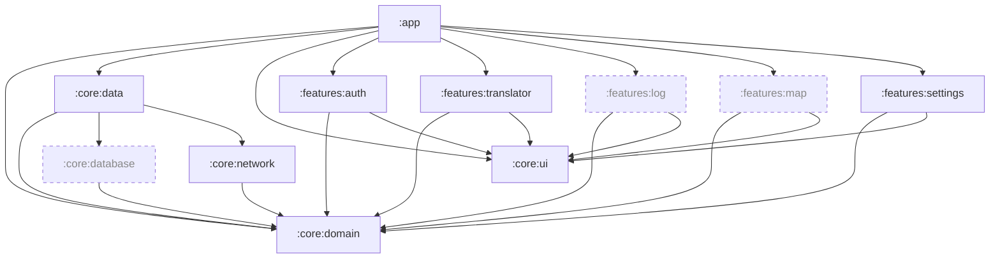

# WanderVox — Project Status Audit

| | |
|---|---|
| **Branch audited** | `Fix/Fix_Merge` @ `b239b71` (up to date with `origin/Fix/Fix_Merge`) |
| **Date** | 2026-10-13 |
| **Scope** | All 11 Gradle modules, version catalog, git history since `acb79a2` |
| **Method** | Read-only. Source inspection, `git log`/`git show`, and `./gradlew help`, `assembleDebug` and `testDebugUnitTest` runs. Nothing was changed except creating this file. Nothing was run on a device or emulator. |

---

## 0. Executive summary

The build is healthy: `assembleDebug` passes with 0 warnings, and all 37 unit tests pass. The login → home (Translator tab) → Settings → logout flow is wired end to end. **Translator** and **Auth** are the only features with real behaviour. **Travel Log** and **Map** have no source code at all, and the translator's "Guardar en bitácora" writes into an **in-memory mock**.

The merge integration left several problems behind:

1. 🔴 **`CLAUDE.md` and `DEV_LOG.md` were deleted** in `f0f2e92` ("Fix del merge"). That removes 690 lines of library justification that the university evaluation requires. Both can be recovered from git (see §1.2).
2. 🔴 **There are two design systems in `:core:ui`** (`com.wandervox.ui.theme` and `com.wandervox.core.ui.theme`). The runtime theme comes from one package, while Auth, Settings and the app shell hard-code colours from the other. The palettes, type scales and font sources differ (§4.1).
3. 🟠 **Domain packages are split** between `com.wandervox.domain.*` (Dev A) and `com.wandervox.core.domain.*` (Dev B) inside the same module (§3.2).
4. 🟠 **Saved log entries can never be retrieved:** `TravelLogEntry.userId` is always `""`, and `coordinates` is always `null` (§5.2).
5. 🟠 **Android Lint crashes**, because lifecycle 2.9.4 is used with AGP 8.7.3 (§2.3).
6. 🟡 The Location permission is shown in Settings, but no manifest declares it, so it can never be granted (§5.3).

---

## 1. Repository health & git state

### 1.1 Working tree and branches

| Check | Result |
|---|---|
| `git status` | Clean. No uncommitted, staged or untracked files. |
| Ahead of `main` | 2 commits (`f0f2e92` Fix del merge, `b239b71` Fix de inicio de traduccion). They are **not merged into `main` yet**. |
| Behind `origin/main` | 0 |
| Stale branches | Local `feat/lau-voice-implementation` and remote `origin/feature/firebase-auth` are both already merged (PR #1, PR #2) and can be deleted. |
| Repository size | Pack size is about **78 MiB**, almost entirely the Vosk models committed as plain files (§1.3). |

### 1.2 Unintentionally deleted files

| File | Status | Deleted in | Recovery |
|---|---|---|---|
| `CLAUDE.md` | ❌ **Missing** (23 lines: architecture invariants and toolchain constraints) | `f0f2e92` "Fix del merge" (LucasDiaz, 2026-10-12) | `git checkout f0f2e92^ -- CLAUDE.md` |
| `DEV_LOG.md` | ❌ **Missing** (690 lines, §1–§8: architecture flow, library justification, concurrency, AI log, design system, Phases 3–4) | `f0f2e92` | `git checkout f0f2e92^ -- DEV_LOG.md` |

Nothing in the commit message or code suggests the deletion was intentional; it reads as merge-conflict collateral. **Restore both before any further work.** Dev B's Auth, Settings and navigation work has no DEV_LOG entry yet and should be added after the restore.

All other deletions in history are expected:
- template `ui/theme` files in `:app`, replaced by `:core:ui`;
- default launcher icons, replaced by `5aef823`;
- the Spanish-named domain stubs from the first commit, replaced in `7d7160a`.

### 1.3 Committed artefacts worth reviewing

| Path | Note |
|---|---|
| `core/network/src/main/assets/models/vosk-model-small-{en-us,es}/` | About 126 MB on disk (68 MB + 58 MB), committed as plain blobs. Every clone downloads them. They also make `assembleDebug` slow, because AGP compresses them into the APK. Options: Git LFS, or `androidResources { noCompress += listOf("mdl", "fst", "dubm", "ie", "mat", "stats") }` in `:core:network`. |
| `app/google-services.json` | Firebase client config (project `wandervox-d2ccb`) is committed. This is not a secret, but the API key should be restricted to the app's package and SHA-1 in Google Cloud Console. The `.gitignore` line for this file is commented out on purpose. |
| `app/src/main/app_icon_source-original.jpg` | Source image placed under `src/main`, outside `res/`. It isn't packaged, but it belongs in a `docs/` or `design/` folder. |

---

## 2. Build & test verification

### 2.1 Commands run

Environment: Gradle 8.14.3, daemon on JDK 17 (via `gradle/gradle-daemon-jvm.properties`), Android Studio JBR as the launcher JDK.

| Command | Result |
|---|---|
| `./gradlew help` | ✅ BUILD SUCCESSFUL (58 s, configuration cache stored) |
| `./gradlew assembleDebug testDebugUnitTest --continue --warning-mode=all` | ✅ **BUILD SUCCESSFUL in 3 m 12 s**, 395 tasks. **0 Kotlin compiler warnings (`w:`), 0 errors, 0 Gradle deprecation warnings.** |

Output: `app/build/outputs/apk/debug/app-debug.apk` is **206 MB**. Its largest entries:

| Entry | Size |
|---|---|
| `classes.dex` (no R8; includes all of `material-icons-extended`) | 42 MB |
| `assets/models/vosk-model-small-*/graph/*.fst` (3 largest files) | 24 + 22 + 22 MB |
| `lib/{x86_64,x86,arm64-v8a,…}/libtranslate_jni.so` (ML Kit, every ABI) | about 17 MB each |

ABI splits or an App Bundle plus R8 in release would cut this substantially (§6, P3).

### 2.2 Unit tests

All **37 tests pass**: 0 failures, 0 errors, 0 skipped.

| Module | Suite | Tests |
|---|---|---|
| `:features:translator` | `TranslatorViewModelTest` | 9 ✅ |
| `:features:translator` | `ShakeDetectorTest` | 6 ✅ |
| `:features:auth` | `AuthViewModelTest` | 9 ✅ |
| `:features:settings` | `SettingsViewModelTest` | 4 ✅ |
| `:core:ui` | `ColorContrastTest` (WCAG 4.5:1 on the runtime scheme) | 2 ✅ |
| 8 modules | `ExampleUnitTest` (template placeholders) | 8 × 1 ✅ |

**Coverage gaps:**
- No tests for `AuthRepositoryImpl` (Firebase exception mapping), `InMemoryLogRepository`, `SessionViewModel`, or `TranslatorRepositoryImpl` (that one needs an instrumented test).
- No UI or instrumented tests at all: the `androidTest` folders hold only the template `ExampleInstrumentedTest`s.

### 2.3 Known build issues

| # | Issue | Severity | Detail / fix |
|---|---|---|---|
| B1 | **Lint crashes** (`IncompatibleClassChangeError` in `NonNullableMutableLiveDataDetector`) | 🟠 | The lint checks bundled with lifecycle 2.9.x are compiled against a newer Lint API than AGP 8.7.3 ships. Fix by upgrading AGP (≥ 8.9), or add `lint { disable += "NullSafeMutableLiveData" }` to each Android module. |
| B2 | Slow `assembleDebug` (minutes when memory is tight) | 🟡 | Dominated by compressing about 126 MB of Vosk assets into the APK. `noCompress` (see §1.3) removes most of it. |
| B3 | `google-services` plugin applied only if `app/google-services.json` exists (`app/build.gradle.kts:11`) | 🟡 | This keeps the build green on machines without the file, but `FirebaseAuth.getInstance()` then crashes at runtime with no build-time signal. Acceptable while the JSON is committed; document it. |

### 2.4 Version catalog review (`gradle/libs.versions.toml`)

| Entry | Finding | Action |
|---|---|---|
| `lifecycleRuntimeKtx = "2.9.4"` | Used for runtime-ktx, viewmodel-ktx and runtime-compose. This is consistent; `f0f2e92` correctly removed the duplicate `lifecycleCompose = "2.8.7"` and duplicate `kotlinx-coroutines-test` / `lifecycle-runtime-compose` keys. | Keep |
| `materialIconsExtended = "1.7.8"` | Pinned outside the Compose BOM (2026.02.01 resolves Compose 1.10.x). `material-icons-extended` stopped at 1.7.8, so this Compose 1.7 artifact sits on a 1.10 runtime. It is also huge (about 30 MB of classes) and there is no R8 (`isMinifyEnabled = false`). | Move to drawable vectors (as `:features:translator` already does), or enable R8 for release |
| `appcompat`, `material` (Views), `osmdroid` | Declared but **not used by any module**. | Remove `appcompat` and `material` (the project is Compose-only); keep `osmdroid` for the Map feature |
| `jetbrainsKotlinJvm = "2.0.21"` | Duplicates `kotlin`; the two can drift apart. | Point the `jetbrains-kotlin-jvm` plugin at `version.ref = "kotlin"` |
| `coreKtx = "1.10.1"`, `activityCompose = "1.8.0"`, `junitVersion`/`espressoCore` | Template-era versions. Higher versions are resolved transitively, so the catalog doesn't show what actually ships. | Bump to the resolved versions in a dedicated PR |
| Room | **Not in the catalog.** `:core:database` has no Room dependency. | Add Room (and the `androidx.room` Gradle plugin) when starting the Travel Log |

---

## 3. Architecture & module review

### 3.1 Module dependency graph (as declared in `build.gradle.kts`)


Dashed nodes are modules with **no main source code**.

| Rule | Verdict | Evidence |
|---|---|---|
| Features depend only on `:core:domain` and `:core:ui` | ✅ | No feature module depends on `:core:data`, `:core:network` or `:core:database`. |
| `:core:domain` is pure Kotlin/JVM | ✅ | `java-library` + `kotlin.jvm` plugins; its only dependency is `kotlinx-coroutines-core`. No `android.*`, `androidx.*` or `com.google.*` imports anywhere in `core/domain/src`. |
| Firebase types stay inside `:core:data` | ✅ | `AuthRepositoryImpl` converts every `FirebaseAuth*Exception` into `AuthException` with a user-facing message (`core/data/.../auth/AuthRepositoryImpl.kt:49-66`). |
| `:app` wires Hilt modules from transitive `implementation` deps | ✅ | `:core:network`'s `NetworkModule` reaches `:app` through `:core:data`. Hilt's aggregating task resolves it (`hiltJavaCompileDebug` was green in Phase 4). |
| Offline STT/translation placed in `:core:network` | ⚠️ Naming debt | `TranslatorRepositoryImpl` is on-device work, not networking. This is acceptable for now; a later rename to `:core:speech` or a move under `:core:data` would make the layering clearer. |

### 3.2 Domain package split (inside `:core:domain`)

| Package | Files | Owner |
|---|---|---|
| `com.wandervox.domain.model` | `TravelLogEntry.kt` (+ `Coordinates`) | Dev A |
| `com.wandervox.domain.repository` | `TranslatorRepository.kt`, `logRepository.kt` (lower-case file name, declares `LogRepository`) | Dev A |
| `com.wandervox.domain` | `MyClass.kt`, an **empty template leftover** | — |
| `com.wandervox.core.domain.model` | `User.kt` | Dev B |
| `com.wandervox.core.domain.repository` | `AuthRepository.kt` | Dev B |

This compiles, but the module now has two roots. **Recommendation:** standardise on `com.wandervox.core.domain` to match `com.wandervox.core.data`, `com.wandervox.core.network` and `com.wandervox.core.ui`. Move the three Dev A files there, rename `logRepository.kt` to `LogRepository.kt`, and delete `MyClass.kt`. Six import sites need updating (two in `:core:data`, one in `:core:network`, three in `:features:translator` main and test).

### 3.3 Hilt bindings

| Module (file) | Kind | Binding | Scope | Status |
|---|---|---|---|---|
| `NetworkModule` (`core/network/.../di/NetworkModule.kt`) | `@Binds` | `TranslatorRepository` ← `TranslatorRepositoryImpl` | `SingletonComponent`, `@Singleton` | ✅ Real |
| `DispatchersModule` (`core/network/.../di/DispatchersModule.kt`) | `@Provides` (justified: framework object) | `@IoDispatcher CoroutineDispatcher` ← `Dispatchers.IO` | `SingletonComponent` | ✅ Real |
| `AuthModule` (`core/data/.../di/AuthModule.kt`) | `@Binds` | `AuthRepository` ← `AuthRepositoryImpl` | `SingletonComponent`, `@Singleton` | ✅ Real |
| `FirebaseModule` (`core/data/.../di/FirebaseModule.kt`) | `@Provides` (justified: SDK singleton) | `FirebaseAuth` ← `FirebaseAuth.getInstance()` | `SingletonComponent`, `@Singleton` | ✅ Real |
| `DataModule` (`core/data/.../di/DataModule.kt`) | `@Binds` | `LogRepository` ← **`InMemoryLogRepository`** | `SingletonComponent`, `@Singleton` | 🟡 **TEMPORARY MOCK.** Entries are lost when the process dies. There is a `TODO` at line 15. |

ViewModels (all `@HiltViewModel`, obtained with `hiltViewModel()`):

| ViewModel | Module | Injected | Scoped to |
|---|---|---|---|
| `SessionViewModel` | `:app` | `AuthRepository` | Activity-level NavHost composable |
| `AuthViewModel` | `:features:auth` | `AuthRepository` | `login` / `register` back-stack entries (separate instances) |
| `TranslatorViewModel` | `:features:translator` | `TranslatorRepository`, `LogRepository` | `translator` entry of the **inner** `MainScaffold` NavHost |
| `SettingsViewModel` | `:features:settings` | `AuthRepository` | `settings` entry |

All bindings follow the project rule: `@Binds` for interface → implementation, and `@Provides` only for the two framework objects, each with a comment explaining why.

---

## 4. Consistency & duplication audit

### 4.1 Two themes in `:core:ui` ⚠️ highest-impact consistency issue

| Aspect | `com.wandervox.core.ui.theme` (Dev A, Phase 2) | `com.wandervox.ui.theme` (Dev B, Auth branch) |
|---|---|---|
| Files | `Color.kt`, `Type.kt`, `Shape.kt`, `Theme.kt` | `Color.kt`, `Type.kt`, `Theme.kt` |
| Entry point | `WanderVoxTheme(content)` | `WanderVoxTheme(content)` (**same name**) |
| Colour names | `ForestGreen`, `NatureGreen`, `MarigoldYellow`, `CanvasMist`, `InkCharcoal`, `SlateGray`, and so on (identical hex values) | `Forest`, `Nature`, `Marigold`, `Neutral`, `TextPrimary`, `TextSecondary` |
| Colour scheme | Full M3 role mapping (containers, inverse, error, outlineVariant). `onSecondary = #00210F` | Partial. **`onSecondary = White` on Nature green = 3.38:1, which fails WCAG AA** (Phase 2 contrast check) |
| Fonts | Poppins **downloaded** via Google Fonts, falling back to device `sans-serif` | Poppins **bundled** (`res/font/poppins_{regular,medium,bold}.ttf`, 476 KB) |
| Type scale | Full M3 scale; titleLarge Medium 22 sp; labelLarge 14 sp | Partial scale; titleLarge Bold 22 sp; labelLarge 16 sp |
| Shapes | `WanderVoxShapes` | M3 defaults |
| Used at runtime? | ✅ **Yes.** `MainActivity.kt:10` wraps the whole NavHost in this theme. | ❌ Its `WanderVoxTheme` appears only in `@Preview`s. Its **colour constants** are hard-coded in 9 files (see below). |

**Who imports what:**

| Consumer | Theme package |
|---|---|
| `app/.../MainActivity.kt` | `core.ui.theme` (runtime) |
| `features/translator/**` (6 files) | `core.ui.theme` |
| `app/.../main/MainScaffold.kt`, `WanderVoxBottomBar.kt` | `ui.theme` constants (`Neutral`, `Forest`, `TextPrimary`, `TextSecondary`) |
| `core/ui/.../ui/components/{SettingsComponents,UnderDevelopment,WanderVoxComponents}.kt` | `ui.theme` |
| `features/auth/**` (3 files) | `ui.theme` |
| `features/settings/**` (2 files) | `ui.theme`, plus literal `Color.White` (`SettingsScreen.kt:256, 365`, `TermsAndConditionsScreen.kt:120`) |

**Practical consequences:**
- **Previews differ from what ships.** Auth and Settings previews use the legacy typography with bundled Poppins; on device they get the core typography with downloadable Poppins and different weights and sizes.
- **Offline-first violation.** At runtime the app depends on *downloaded* Poppins, while the bundled TTFs that would work offline go unused outside previews. On a first launch without connectivity, every screen falls back to the device sans-serif.
- Hard-coded colours bypass `MaterialTheme.colorScheme`, so any palette change has to be made in two places.

**Recommendation (one PR):**
1. Keep `com.wandervox.core.ui.theme` as the single theme.
2. Switch its `PoppinsFontFamily` to the bundled `R.font.poppins_*` files. That removes the `ui-text-google-fonts` dependency, `font_certs.xml` and the `<queries>` block, and gives offline-safe typography.
3. Replace the legacy constants with `MaterialTheme.colorScheme` roles (`Neutral` → `background`, `Forest` → `primary`, `TextSecondary` → `onSurfaceVariant`, `Color.White` → `surfaceContainerLowest`).
4. Move `com.wandervox.ui.components` to `com.wandervox.core.ui.components` and delete `com.wandervox.ui.theme`.

### 4.2 Other duplication and inconsistency

| Area | Finding | Location |
|---|---|---|
| Icons | Two systems: `material-icons-extended` (`:app`, `:core:ui`, Auth, Settings) and Material Symbols vector drawables (Translator). | `features/translator/src/main/res/drawable/ic_*.xml` vs `Icons.Outlined.*` |
| Strings | Translator uses `strings.xml`; Auth, Settings and the app shell hard-code Spanish literals. The `TranslatorViewModel` error messages are **English** inside a Spanish UI (`TranslatorViewModel.kt:156-160`, `TODO`). | — |
| Dead code after `b239b71` | `OfflineBadge` composable is no longer used, and the string `translator_title` is unused. | `features/translator/.../components/OfflineBadge.kt`, `res/values/strings.xml:3` |
| Unused import | `TranslatorRoute` is imported but no longer used. | `app/.../MainActivity.kt:11` |
| System bar appearance | Set twice: `enableEdgeToEdge(SystemBarStyle.light…)` in `MainActivity`, and a `SideEffect` in `core.ui.theme.WanderVoxTheme`. Harmless and consistent, but redundant. | `MainActivity.kt:20`, `core/ui/.../core/ui/theme/Theme.kt:24` |

### 4.3 Layout coordination: `MainScaffold` × `TranslatorScreen`

```
MainActivity (enableEdgeToEdge)
└─ WanderVoxTheme (core.ui.theme)
   └─ WanderVoxNavHost ── login | register | home | settings | terms
      └─ home → MainScaffold  [Scaffold #1: CenterAlignedTopAppBar(logo, ⚙) + WanderVoxBottomBar]
         └─ NavHost.padding(innerPadding).consumeWindowInsets(innerPadding)
            ├─ translator → TranslatorRoute → TranslatorContent [Scaffold #2: no topBar, SnackbarHost only]
            │                   └─ Column.padding(innerPadding2).consumeWindowInsets(innerPadding2)
            ├─ log → UnderDevelopmentScreen
            └─ map → UnderDevelopmentScreen
```

| Check | Verdict |
|---|---|
| Double top bar | ✅ Fixed in `b239b71`: the translator's own `TopAppBar` was removed and `MainScaffold` owns the header. |
| Double status/nav-bar padding | ✅ Fixed in `f0f2e92`: `consumeWindowInsets(innerPadding)` on the inner NavHost means Scaffold #2's default `contentWindowInsets` resolve to 0. |
| Snackbars | ✅ They appear inside the tab content area, above the bottom bar, because Scaffold #2 owns them. |
| Save-to-log `ModalBottomSheet` | ✅ Draws in its own window; uses `navigationBarsPadding()` for the gesture area. |
| Settings / Terms | ✅ Full-screen destinations **outside** `MainScaffold`, each with its own Scaffold and top bar. This avoids stacking headers, and Home keeps its tab state on back. |
| Auth screens | ✅ No Scaffold; `AuthLayout` applies `systemBarsPadding().imePadding()`. |
| "Offline" indicator from the style guide | ⚠️ Lost when the translator top bar was removed. Either add `OfflineBadge` to `MainScaffold`'s actions for the Translator tab, or delete the component. |

---

## 5. Feature-by-feature readiness matrix

**Legend:** `[Production-Ready]` means real implementation, error handling and tests (device QA still pending where noted). `[In-Memory Mock / Stub]` means the interface is real but the backing implementation is temporary. `[UI Only / Visual]` means it renders but performs no real work. `[Pending / Not Started]` means there is no implementation.

### 5.1 Auth (`:features:auth` + `:core:data/auth`)

| Component | Status | Evidence / notes |
|---|---|---|
| Firebase email/password sign-in & sign-up | `[Production-Ready]` | `AuthRepositoryImpl.kt:32-38` (`await()` on Firebase Tasks, wrapped in `Result`). |
| Error handling | `[Production-Ready]` | Maps Firebase exceptions to Spanish messages. Invalid user and invalid password share one message to prevent account enumeration (`AuthRepositoryImpl.kt:54-66`). Rethrows `CancellationException`. |
| Password policy | `[Production-Ready]` | Register only: at least 8 characters, at least one letter and one digit (`AuthViewModel.kt:72`). Not enforced on login, on purpose, for legacy accounts. Email regex validation. |
| Auto-login | `[Production-Ready]` | `SessionViewModel` waits for the first `currentUser` emission (Firebase's persisted session), then picks `home` or `login`. A blank themed `Box` shows while checking. |
| Double-submit guard | `[Production-Ready]` | `AuthViewModel.submit` ignores calls while `Loading`. |
| Tests | ✅ | `AuthViewModelTest` (9 tests). |
| Gaps | — | No password reset, no email verification, no Google sign-in. The session is resolved once at start: a token revoked server-side is noticed only on restart. Messages are hard-coded rather than string resources. |

### 5.2 Translator (`:features:translator` + `:core:network`)

| Component | Status | Evidence / notes |
|---|---|---|
| Offline STT (Vosk 0.3.47) | `[Production-Ready]`, pending device QA | `TranslatorRepositoryImpl.kt`: per-session generation counter, FIFO `Mutex`, `NonCancellable` microphone release, one model in RAM (about 300 MB each). ES and EN small models are bundled and extracted by `VoskModelManager`. |
| Offline translation (ML Kit 17.0.3) | `[Production-Ready]`, pending device QA | `MlKitTranslatorClient` checks or downloads the language packs, then translates fully on-device. **The first launch needs connectivity** to download the packs (`DownloadConditions` with no Wi-Fi requirement). Partial results are debounced by 300 ms. |
| Language swap (button + shake) | `[Production-Ready]` | `ShakeDetector.kt`: two peaks above 2.5 g within 600 ms, 1.5 s cooldown. The sensor is registered only while RESUMED (`LifecycleResumeEffect`, `SENSOR_DELAY_UI`), and disabled while models load or the save sheet is open. 6 unit tests. |
| UI state flow (UDF/MVI) | `[Production-Ready]` | `TranslatorViewModel` combines repository `StateFlow`s with presentation state using `stateIn(WhileSubscribed(5_000))`. The screen collects with `collectAsStateWithLifecycle`. One-off messages are consumed via `OnResetSaveSuccess` / `OnDismissError`. 9 unit tests. |
| RECORD_AUDIO permission | `[Production-Ready]` | Requested on the first mic tap. On denial a snackbar offers "Reintentar", or "Ajustes" if the user chose "don't ask again". The repository re-checks the permission before opening the mic. |
| Screen layout | `[Production-Ready]` | Language pills + swap, recognized/translated cards (copy to clipboard), animated Marigold mic button, save sheet with 5 categories + notes. 48 dp minimum touch targets; `liveRegion` on the translation. |
| Text-to-speech button | `[UI Only / Visual]` | Rendered disabled in `TranslationCards.kt` (`TranslatedTextCard`). |
| "Guardar en bitácora" | `[In-Memory Mock / Stub]` | Goes to `InMemoryLogRepository`. **`userId` is never set** (`TranslatorViewModel.kt:125-134` builds `TravelLogEntry` without it, so it defaults to `""`), which means `getUserEntries(uid)` will never return these entries. `coordinates = null` (no location yet). |
| Gaps | — | Only the ES↔EN pair. English error strings. No reduced-motion handling for the mic pulse. Not exercised on a physical device in this audit. |

### 5.3 Settings (`:features:settings`)

| Component | Status | Evidence / notes |
|---|---|---|
| Logout flow | `[Production-Ready]` | Confirmation dialog → `AuthRepository.signOut()` → `isLoggedOut` → `navigateToLogin()` clears the whole back stack (`WanderVoxNavHost.kt:103-108`). Popping Home clears `TranslatorViewModel`, which calls `release()` and frees Vosk and ML Kit. 4 unit tests. |
| Account email | `[Production-Ready]` | Read live from `AuthRepository.currentUser`. |
| "Modo offline forzado" switch | `[UI Only / Visual]` | In-memory `SettingsUiState.isOfflineModeEnabled`, not persisted and not read by anything (`SettingsViewModel.kt:18`, `TODO`). |
| "Sincronización de Bitácora" | `[Pending / Not Started]` | Disabled row with a development badge. |
| Microphone permission row | `[Production-Ready]` | Real status, refreshed on every resume (`LifecycleResumeEffect`), and opens the app's system settings. |
| Location permission row | 🟠 `[UI Only / Visual]` | Checks `ACCESS_FINE/COARSE_LOCATION`, but **no manifest declares them**, so the row always shows "not granted" and the system settings page has nothing to toggle. |
| App version | `[Production-Ready]` | `BuildConfig.VERSION_NAME`, passed in from `:app`. |
| Terms & Conditions | `[UI Only / Visual]` | Static, hard-coded Spanish text in `TermsAndConditionsScreen.kt`. Fine for an MVP; it has no acceptance step at registration. |

### 5.4 Travel Log (`:features:log` + `:core:database`)

| Component | Status | Evidence / notes |
|---|---|---|
| Domain contract | `[Production-Ready]` | `LogRepository` with user and community feeds, save, like and delete, all returning `Result`; `TravelLogEntry` model. |
| Repository implementation | `[In-Memory Mock / Stub]` | `InMemoryLogRepository` (`MutableStateFlow` list; marked TEMPORARY). |
| Room database | `[Pending / Not Started]` | `:core:database` contains only template tests. No Room dependency, entities, DAO or `@Database`. Hilt and KSP plugins are applied but unused. |
| Firestore sync | `[Pending / Not Started]` | No Firestore dependency. `isPublic` and `likes` fields exist in the model only. |
| UI | `[Pending / Not Started]` | `:features:log` has no main sources. The "Bitácora" tab shows `UnderDevelopmentScreen`. |

### 5.5 Map (`:features:map`)

| Component | Status | Evidence / notes |
|---|---|---|
| OSMDroid integration | `[Pending / Not Started]` | `osmdroid-android 6.1.18` is in the catalog but not added to any module. |
| GPS location | `[Pending / Not Started]` | No location permission, no `FusedLocationProviderClient` or `LocationManager` code. `Coordinates` exists in the domain only. |
| Entry markers | `[Pending / Not Started]` | Depends on the Travel Log persistence. |
| UI | `[Pending / Not Started]` | The "Mapa" tab shows `UnderDevelopmentScreen`. |

### 5.6 Summary matrix

| Feature | Production-Ready | Mock / Stub | UI Only | Pending |
|---|:-:|:-:|:-:|:-:|
| Auth | ● | | | (reset, verification) |
| Translator: STT, translation, shake, permission, UDF | ● | | | |
| Translator: save to log | | ● | | |
| Translator: TTS | | | ● | |
| Settings: logout, mic permission, version | ● | | | |
| Settings: offline switch, location row, T&C | | | ● | |
| Settings: log sync | | | | ● |
| Travel Log (data + UI) | | ● (repo) | | ● (Room, Firestore, UI) |
| Map | | | | ● |

---

## 6. Actionable roadmap & technical debt

### P0: before any new feature work

| # | Task | Owner | Files |
|---|---|---|---|
| 1 | Restore `CLAUDE.md` and `DEV_LOG.md` with `git checkout f0f2e92^ -- CLAUDE.md DEV_LOG.md`, then add a DEV_LOG section for Auth, Settings and navigation (Firebase justification, the anti-enumeration decision, session check). | A + B | root |
| 2 | Open the PR `Fix/Fix_Merge` → `main` once item 1 is included. | B | — |
| 3 | Fix the Lint crash: upgrade AGP, or disable `NullSafeMutableLiveData` per module. | A | `gradle/libs.versions.toml` or each `build.gradle.kts` |

### P1: consolidation (one PR each, no behaviour change)

| # | Task | Files |
|---|---|---|
| 4 | **Single theme**: keep `com.wandervox.core.ui.theme`, switch Poppins to the bundled TTFs (offline-first), replace legacy colour constants with `MaterialTheme.colorScheme` roles, move `ui.components` under `core.ui.components`, delete `com.wandervox.ui.theme`. | `core/ui/**`, `app/.../main/*`, `features/auth/**`, `features/settings/**` |
| 5 | **Single domain package** `com.wandervox.core.domain`: move the Dev A files, rename `logRepository.kt`, delete `MyClass.kt`. | `core/domain/**` + 6 import sites |
| 6 | Set `TravelLogEntry.userId` when saving: resolve the current user in the data layer (`LogRepository` impl reads `AuthRepository`), or inject `AuthRepository` into `TranslatorViewModel`. | `TranslatorViewModel.kt`, `core/data/**` |
| 7 | Remove dead code: the unused import in `MainActivity`, `OfflineBadge` (or re-host it in `MainScaffold`), the `translator_title` string, and the unused catalog entries (`appcompat`, `material`). | listed in §4.2 / §2.4 |
| 8 | Strings to resources in Auth, Settings and the shell; turn the translator VM errors into Spanish resources (`UiText`). | feature modules |

### P2: next development phase

| # | Task | Notes |
|---|---|---|
| 9 | **Travel Log persistence**: add Room to the catalog; build `TravelLogEntity`, DAO and `WanderVoxDatabase` in `:core:database`; write `LogRepositoryImpl` in `:core:data` (Room as the source of truth, Firestore sync later); change the `DataModule` binding. | Replaces `InMemoryLogRepository` |
| 10 | **Location**: declare `ACCESS_COARSE/FINE_LOCATION`, add a location provider in the data layer, and fill `coordinates` on save. | Fixes the Settings location row |
| 11 | **Log UI** (`:features:log`): list, filter by category, detail and delete. | Turns off the `inDevelopment` flag on `MainTab.Log` |
| 12 | **Map** (`:features:map`): add OSMDroid (`AndroidView` wrapper), offline tile cache and entry markers. | Turns off the `inDevelopment` flag on `MainTab.Map` |
| 13 | Wire or remove the "Modo offline forzado" switch (DataStore if kept). | `SettingsViewModel.kt:18` |

### P3: hygiene

| # | Task |
|---|---|
| 14 | Vosk assets: `noCompress` for faster builds; consider Git LFS or downloading the models on first run. |
| 14b | APK size (206 MB debug): ABI `splits` or an App Bundle, plus R8 (`isMinifyEnabled = true` with Vosk/JNA keep rules already in `core/network/consumer-rules.pro`) for release. |
| 15 | Replace `material-icons-extended` with vector drawables, or enable R8 for release builds. |
| 16 | CI (GitHub Actions): `assembleDebug`, `testDebugUnitTest`, `lint` on every PR, so merge breakage like `f0f2e92` gets caught. |
| 17 | Device QA checklist for the translator: permission denial paths, shake sensitivity, TalkBack, first offline launch. |
| 18 | Delete merged branches (`feat/lau-voice-implementation`, `origin/feature/firebase-auth`). |
