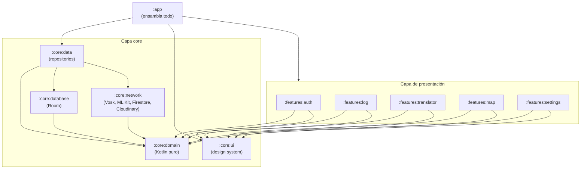
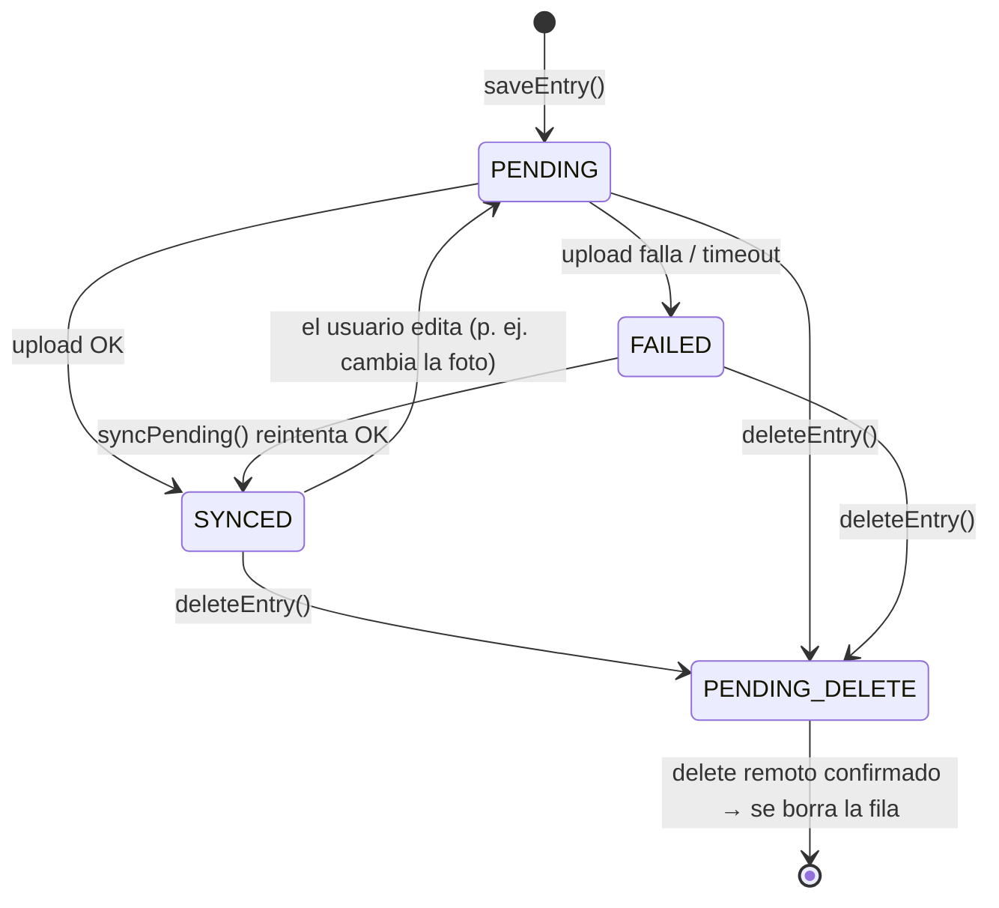
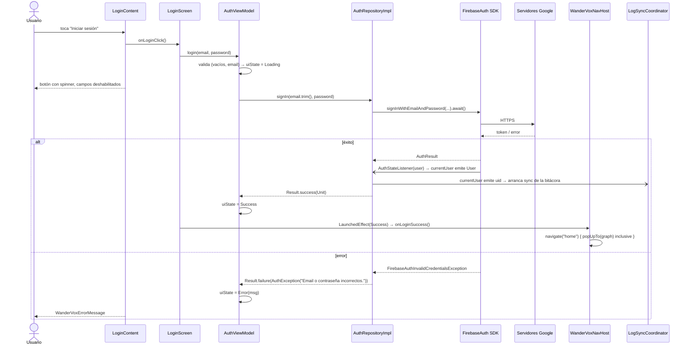
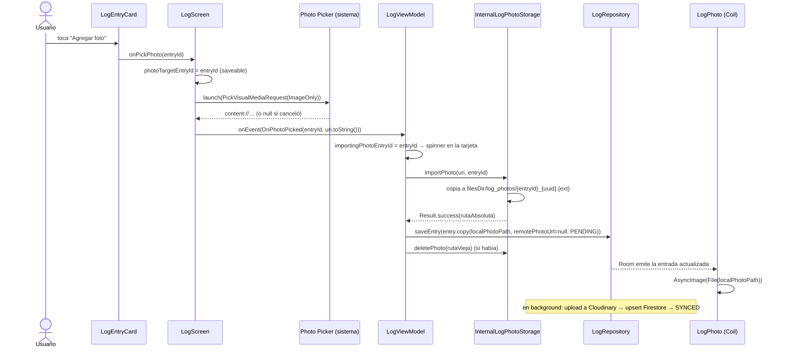

# PROJECT_WALKTHROUGH — Guía técnica integral de WanderVox

> **Para:** Lucas (Dev B) · **Estado del código:** rama `main`, commit `c03664c` (2026-10-20)
> **Objetivo:** entender y poder defender cada parte del proyecto como si lo hubieras escrito desde cero.

Esta guía describe **el código tal como está hoy**, no como se planeó. Cada afirmación está tomada del
código fuente; cuando algo está incompleto o tiene un punto débil, se dice explícitamente (ver §9). Las
referencias tienen la forma `ruta/al/Archivo.kt` para que puedas abrirlas directamente.

---

## Índice

1. [Visión general y arquitectura modular](#1-visión-general-y-arquitectura-modular)
2. [Mapa de carpetas y recorrido módulo por módulo](#2-mapa-de-carpetas-y-recorrido-módulo-por-módulo)
3. [Inmersión técnica: Autenticación con Firebase y sesión](#3-inmersión-técnica-autenticación-con-firebase-y-sesión)
4. [Inmersión técnica: Mi Track — la Bitácora (`:features:log`)](#4-inmersión-técnica-mi-track--la-bitácora-featureslog)
5. [El motor offline-first: Room ↔ Firestore ↔ Cloudinary](#5-el-motor-offline-first-room--firestore--cloudinary)
6. [Flujos end-to-end paso a paso](#6-flujos-end-to-end-paso-a-paso)
7. [Testing](#7-testing)
8. [Configuración, secretos y build](#8-configuración-secretos-y-build)
9. [Limitaciones conocidas y puntos débiles (para no ser sorprendido)](#9-limitaciones-conocidas-y-puntos-débiles)
10. [Preguntas probables en la defensa (con respuesta)](#10-preguntas-probables-en-la-defensa)
11. [Glosario rápido](#11-glosario-rápido)

---

## 1. Visión general y arquitectura modular

### 1.1 Qué es WanderVox

Una app Android de asistencia para viajeros con tres funciones visibles (las pestañas de la barra
inferior) y una transversal:

| Pestaña / función | Qué hace | Módulo | Track |
|---|---|---|---|
| **Traductor** | Voz → texto offline (Vosk) → traducción offline (ML Kit). Sacudir el teléfono invierte idiomas. Botón "Guardar en bitácora". | `:features:translator` | Dev A |
| **Bitácora** | Lista de entradas guardadas: "Mis viajes" y "Comunidad", filtros, fotos, likes, borrado, estado de sincronización. | `:features:log` | **Dev B (vos)** |
| **Mapa** | Pinta en OpenStreetMap las entradas propias que tienen coordenadas. | `:features:map` | Dev A |
| **Cuenta / Ajustes** | Login, registro, cierre de sesión, permisos, términos. | `:features:auth`, `:features:settings` | Dev B |

La premisa central es **offline-first**: todo lo que el usuario necesita en un viaje (traducir, guardar,
ver su bitácora, ver el mapa ya cacheado) funciona sin conexión; la red solo sirve para *replicar* y
*compartir*.

### 1.2 Filosofía: Clean Architecture multi-módulo

El proyecto está partido en **11 módulos Gradle** (`settings.gradle.kts`). La regla de oro es la
**dirección de las dependencias**: siempre apuntan hacia el dominio, nunca al revés.



Lo que este grafo garantiza (y lo podés verificar en cada `build.gradle.kts`):

- **Ningún módulo `:features:*` depende de `:core:data`, `:core:network` ni `:core:database`.** Las
  features solo conocen *interfaces* del dominio (`AuthRepository`, `LogRepository`…). No saben que
  existe Firebase, Room ni Cloudinary.
- **`:core:domain` no depende de nada de Android.** Es un módulo `java-library` + `kotlin.jvm`
  (`core/domain/build.gradle.kts`); su única dependencia es `kotlinx-coroutines-core` (para `Flow`). Si
  alguien importara `android.*` ahí, el build fallaría.
- **`:app` es el único que ve todo.** Su trabajo es *ensamblar*: Hilt necesita ver los módulos de
  `:core:data` para generar el grafo, por eso `:app` depende de `:core:data` aunque no use sus clases directamente.
- **Las features no se conocen entre sí.** `:features:translator` guarda en la bitácora a través de
  `LogRepository` (dominio), no importando `:features:log`.

### 1.3 Principios inmutables del proyecto (de `CLAUDE.md`)

1. **Dominio puro:** `:core:domain` sin Android SDK.
2. **100 % Jetpack Compose:** no hay layouts XML de vistas. Los únicos XML en `res/` son recursos
   (strings, íconos vectoriales, tema de la ventana, reglas de backup). La única "vista clásica" es el
   `MapView` de OSMDroid, envuelto en `AndroidView` porque no existe un mapa OSM nativo de Compose.
3. **UDF / MVI:** cada pantalla expone **un único** `UiState` inmutable vía `StateFlow`, la UI lo
   consume con `collectAsStateWithLifecycle()` y le devuelve **eventos** (`onEvent(...)`).
4. **Hilt en todo**, prefiriendo `@Binds` (interfaz → implementación) y usando `@Provides` solo cuando
   el objeto no tiene un constructor inyectable (SDKs, `Room`, `Dispatchers`).
5. **Offline-first:** degradar a cachés locales (modelos Vosk empaquetados, packs de ML Kit, Room,
   caché persistente de Firestore, tiles de OSMDroid).
6. **`Result<T>`** para envolver resultados asíncronos que pueden fallar.

### 1.4 Stack técnico (de `gradle/libs.versions.toml`)

| Área | Librería | Versión |
|---|---|---|
| Build | Gradle / AGP / KSP | 8.14.3 / 8.7.3 / 2.0.21-1.0.28 |
| Lenguaje | Kotlin (JVM 17) | 2.0.21 |
| UI | Compose BOM / Material 3 / Navigation Compose | 2026.02.01 / (BOM) / 2.8.5 |
| DI | Hilt / hilt-navigation-compose | 2.51.1 / 1.2.0 |
| Concurrencia | kotlinx-coroutines | 1.8.1 |
| Backend | Firebase BOM (Auth + Firestore) | 33.7.0 |
| Persistencia local | Room | 2.6.1 |
| Imágenes | Coil (compose) | 2.7.0 |
| HTTP | OkHttp | 4.12.0 |
| Voz | Vosk Android | 0.3.47 |
| Traducción | ML Kit Translate | 17.0.3 |
| Mapa | OSMDroid | 6.1.18 |

SDK: `minSdk 27`, `compileSdk 35`, `targetSdk 35`.

---

## 2. Mapa de carpetas y recorrido módulo por módulo

### 2.1 Raíz del repositorio

```
WanderVox-app/
├── app/                     → Módulo aplicación (Activity, Application, navegación)
├── core/
│   ├── domain/              → Modelos y contratos (Kotlin puro)
│   ├── data/                → Implementaciones de repositorios + DI de Firebase
│   ├── database/            → Room (entidad, DAO, conversores, mapper)
│   ├── network/             → Vosk, ML Kit y el paquete remote/ (Firestore, Cloudinary)
│   └── ui/                  → Design system (tema, colores, tipografía, componentes)
├── features/
│   ├── auth/  log/  map/  settings/  translator/
├── docs/                    → DEV_LOG.md, reportes por etapa, esta guía
├── gradle/libs.versions.toml→ Catálogo de versiones (fuente única de versiones)
├── settings.gradle.kts      → Declara los 11 módulos y repositorios (incluye el Maven de Vosk)
├── build.gradle.kts         → Plugins a nivel raíz (apply false)
├── gradle.properties        → Flags de Gradle/AndroidX
├── local.properties         → (NO versionado) ruta del SDK + credenciales Cloudinary
└── CLAUDE.md                → Reglas de arquitectura del proyecto
```

Cada módulo Android tiene la misma estructura estándar: `build.gradle.kts`, `src/main/` (código +
`AndroidManifest.xml` + `res/`), `src/test/` (tests JVM) y `src/androidTest/` (instrumentados; hoy solo
plantillas). Los `consumer-rules.pro`/`proguard-rules.pro` están vacíos porque `isMinifyEnabled = false`.

Un detalle que se repite en todos los `build.gradle.kts`: el bloque `lint { disable += ... }`. Lifecycle
2.9.x y Compose 1.10.x traen checks de lint compilados contra una API más nueva que la de AGP 8.7.3,
que hacen crashear a lint; se desactivan esos tres checks hasta subir a AGP ≥ 8.9.

---

### 2.2 `:app` — el ensamblador

```
app/src/main/java/com/wandervox/app/
├── WanderVoxApp.kt          → @HiltAndroidApp; arranca LogSyncCoordinator
├── MainActivity.kt          → @AndroidEntryPoint; edge-to-edge + WanderVoxTheme + NavHost
├── navigation/
│   ├── SessionViewModel.kt  → ¿hay sesión guardada? (Checking / Authenticated / Unauthenticated)
│   └── WanderVoxNavHost.kt  → Grafo raíz: login, register, home, settings, terms
└── main/
    ├── MainScaffold.kt      → TopBar + NavHost interno de pestañas + BottomBar
    ├── MainTab.kt           → enum de pestañas (ruta, etiqueta, ícono)
    └── WanderVoxBottomBar.kt→ NavigationBar de Material 3 (sin estado)
```

**`WanderVoxApp`** — La clase `Application`. `@HiltAndroidApp` dispara la generación del contenedor de
Hilt de nivel aplicación (`SingletonComponent`). En `onCreate()` inyecta y arranca
`LogSyncCoordinator.start()`, que vive mientras viva el proceso (ver §5.4).

**`MainActivity`** — Única Activity. Llama a `enableEdgeToEdge()` forzando barras de sistema *claras*
(la app solo tiene paleta clara) y monta `WanderVoxTheme { WanderVoxNavHost() }`.

**`WanderVoxNavHost`** — Hay **dos niveles de navegación**:

```
NavHost raíz (WanderVoxNavHost)
├── "login"     → LoginScreen
├── "register"  → RegisterScreen
├── "home"      → MainScaffold ──► NavHost interno de pestañas
│                                   ├── "translator" → TranslatorRoute
│                                   ├── "log"        → LogScreen
│                                   └── "map"        → MapScreen
├── "settings"  → SettingsScreen   (fuera del scaffold, a pantalla completa)
└── "terms"     → TermsAndConditionsScreen
```

Decisiones a saber defender:

- **El destino inicial depende de la sesión.** Mientras `SessionState.Checking`, se dibuja solo un `Box`
  con el color de fondo (continuidad visual con el splash) y se hace `return`; recién después se crea
  el `NavHost` con `startDestination = HOME` o `LOGIN`. Así nunca se ve un "flash" del login para un
  usuario que ya estaba logueado.
- **`navigateToHome()` / `navigateToLogin()`** usan `popUpTo(graph.id) { inclusive = true }`: limpian
  todo el back stack para que "atrás" desde Home no vuelva al Login (y viceversa tras el logout).
- **Settings vive fuera de `MainScaffold`**: Home queda en el back stack con la pestaña activa guardada;
  al volver, se restaura exactamente donde estabas.
- **Las features reciben callbacks, no el `NavController`.** `LoginScreen(onLoginSuccess = …)`: la
  feature no sabe a dónde se navega, solo avisa "terminé". Esto mantiene a las features desacopladas
  de la topología de navegación.

**`MainScaffold`** — `Scaffold` con `CenterAlignedTopAppBar` (logo + engranaje de Ajustes) y
`WanderVoxBottomBar`. Recibe el contenido del Traductor y la Bitácora como *lambdas composables*
(`translatorContent`, `logContent`), lo que permite que `:app` decida qué se inyecta. El cambio de
pestaña usa el patrón estándar de bottom navigation:
`popUpTo(startDestination) { saveState = true }; launchSingleTop = true; restoreState = true` →
una sola instancia por pestaña y el estado (scroll, pestaña interna) se preserva.
`consumeWindowInsets(innerPadding)` evita que pantallas con su propio `Scaffold` (el Traductor) sumen
dos veces el inset de la barra de estado.

**`MainTab`** — `enum` con `route`, `label`, `icon` e `inDevelopment` (si es `true`, la barra muestra un
badge "Próximamente"; hoy las tres están en `false`).

---

### 2.3 `:core:domain` — el corazón (Kotlin puro)

```
core/domain/src/main/java/com/wandervox/core/domain/
├── model/
│   ├── User.kt             → data class User(uid, email?)
│   ├── TravelLogEntry.kt   → la entrada de bitácora + Coordinates(lat, lng)
│   ├── LogCategory.kt      → FOOD, TRANSPORT, LODGING, SHOPPING, EMERGENCY, GENERAL
│   └── SyncStatus.kt       → PENDING, SYNCED, FAILED, PENDING_DELETE
└── repository/
    ├── AuthRepository.kt
    ├── LogRepository.kt
    ├── LocationRepository.kt
    └── TranslatorRepository.kt
```

**`TravelLogEntry`** es el modelo más importante del proyecto. Campos y su propósito:

| Campo | Tipo | Para qué |
|---|---|---|
| `id` | `String` | UUID generado en el cliente (permite crear offline sin pedirle un id al servidor). |
| `userId` | `String` | Dueño (UID de Firebase). |
| `originalText` / `translatedText` | `String` | La frase y su traducción. |
| `sourceLanguage` / `targetLanguage` | `String` | `"ES"`, `"EN"`. |
| `timestamp` | `Long` | Momento de creación (orden de la lista). |
| `coordinates` | `Coordinates?` | Geotag opcional (para el Mapa). |
| `localPhotoPath` | `String?` | Copia de la foto en el sandbox. **Nunca sale del dispositivo.** |
| `remotePhotoUrl` | `String?` | URL HTTPS de Cloudinary, para otros dispositivos y la Comunidad. |
| `category` | `LogCategory` | Filtro y etiqueta. |
| `notes` | `String` | Nota libre del usuario. |
| `isPublic` | `Boolean` | Si aparece en "Comunidad". |
| `likes` | `List<String>` | UIDs que dieron like (el conteo es `likes.size`). |
| `authorName` | `String?` | Nombre visible en Comunidad. |
| `updatedAt` | `Long` | Versión para resolver conflictos (last-write-wins). |
| `syncStatus` | `SyncStatus` | Estado de réplica. **Nunca sale del dispositivo.** |

**`LogCategory`**: el **nombre del enum** (`"FOOD"`) es el valor persistido en Room y Firestore; es
estable e independiente del idioma. Las etiquetas visibles ("Comida") viven en los `strings.xml` de cada
feature.

**`SyncStatus`**: modela el ciclo de vida de la réplica:



**Repositorios (interfaces):**

```kotlin
interface AuthRepository {
    val currentUser: Flow<User?>
    suspend fun signIn(email: String, password: String): Result<Unit>
    suspend fun signUp(email: String, password: String): Result<Unit>
    suspend fun signOut(): Result<Unit>
}

interface LogRepository {
    fun getUserEntries(userId: String): Flow<List<TravelLogEntry>>
    fun getCommunityEntries(): Flow<List<TravelLogEntry>>
    fun getEntry(entryId: String): Flow<TravelLogEntry?>
    suspend fun saveEntry(entry: TravelLogEntry): Result<Unit>
    suspend fun toggleLike(entryId: String, userId: String): Result<Unit>
    suspend fun deleteEntry(entryId: String): Result<Unit>
    suspend fun syncPending(): Result<Unit>
}
```

Patrón a notar: **lecturas = `Flow`** (reactivas, la UI se actualiza sola cuando cambian los datos);
**escrituras = `suspend fun` que devuelven `Result`** (una operación puntual que puede fallar).

`LocationRepository.getCurrentLocation(): Result<Coordinates>` y `TranslatorRepository` (con
`StateFlow`s de texto reconocido / traducido / escuchando) completan el contrato.

---

### 2.4 `:core:data` — implementaciones de repositorios

```
core/data/src/main/java/com/wandervox/core/data/
├── auth/AuthRepositoryImpl.kt         → Firebase Auth detrás de AuthRepository (ver §3)
├── repository/
│   ├── OfflineFirstLogRepository.kt   → Room = verdad; Firestore/Cloudinary = réplica (ver §5)
│   └── LogSyncCoordinator.kt          → arranca/cancela la sincronización según el usuario logueado
├── location/LocationRepositoryImpl.kt → ubicación one-shot con LocationManager (sin Play Services)
├── di/
│   ├── FirebaseModule.kt              → @Provides FirebaseAuth
│   ├── AuthModule.kt                  → @Binds AuthRepository
│   ├── DataModule.kt                  → @Binds LogRepository, LocationRepository
│   └── CoroutineScopeModule.kt        → @ApplicationScope CoroutineScope (SupervisorJob + Default)
└── util/ResultExtensions.kt           → runSuspendCatching
```

**`runSuspendCatching`** — Variante de `runCatching` que **re-lanza `CancellationException`** (si la
tragara, una corrutina cancelada seguiría ejecutándose como si nada, rompiendo la concurrencia
estructurada) y que solo atrapa `Exception` (no `Error`, como `OutOfMemoryError`). Se usa en todo el
proyecto en lugar de `runCatching` "a secas".

**`@ApplicationScope`** — Un `CoroutineScope` singleton de proceso. Se usa para trabajo que debe
**sobrevivir a la pantalla que lo inició**: si guardás una entrada y salís de la pantalla, la subida a
Firestore no se cancela. `SupervisorJob` hace que el fallo de una sincronización no cancele las demás.

**`LocationRepositoryImpl`** — Estrategia: si hay una última ubicación conocida de menos de 2 minutos,
la devuelve al instante; si no, pide una nueva al mejor proveedor disponible (fused → network → GPS)
con timeout de 10 s; si no llega, usa la última conocida de cualquier antigüedad. Usa
`LocationManager` de la plataforma para no depender de Google Play Services. Falla con
`LocationPermissionException` si no hay permiso.

---

### 2.5 `:core:network` — todo lo que habla con algo externo

```
core/network/src/main/
├── AndroidManifest.xml          → permisos RECORD_AUDIO e INTERNET
├── assets/models/               → modelos Vosk empaquetados (es, en-us)
└── java/com/wandervox/core/network/
    ├── speech/VoskModelManager.kt          → extrae modelos de assets a filesDir (atómico)
    ├── translation/MlKitTranslatorClient.kt→ packs de idioma + traductores por dirección
    ├── repository/TranslatorRepositoryImpl.kt → micrófono → Vosk → ML Kit (Track A)
    ├── model/                              → SupportedLanguage, VoskModelState, excepciones
    ├── remote/                             ← ★ Track B
    │   ├── log/LogRemoteDataSource.kt          (interfaz)
    │   ├── log/FirestoreLogRemoteDataSource.kt (implementación Firestore)
    │   ├── log/LogEntryFirestoreMapper.kt      (TravelLogEntry ↔ Map, sin tipos Firebase)
    │   ├── image/ImageUploader.kt              (interfaz)
    │   └── image/CloudinaryImageUploader.kt    (upload unsigned con OkHttp)
    ├── di/
    │   ├── NetworkModule.kt        → @Binds TranslatorRepository
    │   ├── NetworkRemoteModule.kt  → @Binds remote + @Provides Firestore/OkHttp/CloudinaryConfig
    │   └── DispatchersModule.kt    → @IoDispatcher
    └── util/
        ├── ResultExtensions.kt     → runSuspendCatching (copia interna del módulo)
        └── TaskExtensions.kt       → Task<T>.awaitResult(): puente Play Services Task → suspend
```

**Parte de Dev A (Vosk + ML Kit), en breve, para que puedas responder si te preguntan:**

- **`VoskModelManager`**: Vosk necesita una ruta real de disco, no un asset dentro del APK. Copia
  `assets/models/<modelo>` a `filesDir/models/<modelo>` dentro de un directorio `.staging`, escribe un
  archivo marcador `.extraction_complete` al final y recién entonces renombra al destino. Si el proceso
  muere a mitad de la copia, nunca queda un modelo "a medias" que parezca válido. Un `Mutex` serializa
  las extracciones y expone un `StateFlow<Map<SupportedLanguage, VoskModelState>>`.
- **`MlKitTranslatorClient`**: descarga (una sola vez, sin exigir Wi-Fi) los packs de idioma y abre
  traductores para ambas direcciones (ES→EN y EN→ES) para que el swap funcione offline.
- **`TranslatorRepositoryImpl`**: abre el micrófono con `SpeechService` de Vosk a 16 kHz; los resultados
  parciales se traducen con *debounce* de 300 ms. Un contador `sessionGeneration` invalida callbacks
  tardíos de sesiones anteriores. Mantiene un solo modelo Vosk cargado (~300 MB de RAM cada uno).
- **`SupportedLanguage`**: hoy solo `SPANISH` y `ENGLISH` (los dos modelos empaquetados).

**Parte de Dev B (`remote/`)** — se explica en detalle en §4.7 y §5.

---

### 2.6 `:core:database` — Room (Track A, pero tu bitácora vive acá)

```
core/database/
├── schemas/…/1.json                 → esquema exportado de la versión 1
└── src/main/java/com/wandervox/core/database/
    ├── WanderVoxDatabase.kt         → @Database(entities=[TravelLogEntity], version=1)
    ├── entity/TravelLogEntity.kt    → tabla travel_logs (índices: userId, isPublic, syncStatus)
    ├── dao/TravelLogDao.kt          → queries observables + operaciones del motor de sync
    ├── converter/Converters.kt      → likes, LogCategory y SyncStatus ↔ String
    ├── mapper/TravelLogMapper.kt    → asDomain() / asEntity()
    └── di/DatabaseModule.kt         → @Provides DB y DAO
```

Detalles defendibles:

- **Coordenadas aplanadas** en dos columnas `latitude`/`longitude` nullable; el mapper reconstruye
  `Coordinates` solo si ambas son no nulas.
- **`Converters`**: los enums se guardan por **nombre**. Si aparece un valor desconocido (escrito por
  una versión futura de la app), cae a un default seguro en vez de crashear: `LogCategory.GENERAL` y
  `SyncStatus.PENDING` (así la entrada se reintenta en lugar de perderse). Los likes se guardan como un
  `String` unido por el carácter ASCII `\u001F` ("unit separator"), que nunca aparece en un UID de
  Firebase → no hace falta una librería JSON para una lista plana.
- **Las queries observadas ocultan los *tombstones*** (`syncStatus != 'PENDING_DELETE'`): para la UI,
  una entrada borrada desaparece al instante aunque la fila siga existiendo hasta confirmar el borrado
  remoto.
- **Operaciones *compare-and-set*** (`updateSyncResult`, `updateFromRemote`, `deleteTombstone`): todas
  llevan `WHERE ... AND updatedAt = :esperado`. Si la fila cambió mientras se sincronizaba, el UPDATE
  afecta 0 filas y el motor lo detecta. Es concurrencia optimista implementada en SQL.
- **`DatabaseModule` usa `@Provides`** porque Room genera la implementación; no hay clase para `@Binds`.

---

### 2.7 `:core:ui` — el design system

```
core/ui/src/main/
├── res/font/poppins_{regular,medium,bold}.ttf   → tipografía empaquetada (~476 KB)
└── java/com/wandervox/core/ui/
    ├── theme/
    │   ├── Color.kt   → paleta de marca + LightColorScheme (tokens M3)
    │   ├── Type.kt    → PoppinsFontFamily + escala tipográfica M3
    │   ├── Shape.kt   → formas M3 (chips = píldora, cards 16 dp, sheets 24 dp)
    │   └── Theme.kt   → WanderVoxTheme { MaterialTheme(...) }
    └── components/
        ├── WanderVoxComponents.kt → Logo, PrimaryButton, TextField, PasswordField, ErrorMessage, TextLink, FieldHint
        ├── SettingsComponents.kt  → SettingsSection, SettingsItem, SwitchItem, Divider, StatusChip
        └── UnderDevelopment.kt    → DevelopmentBadge, UnderDevelopmentScreen
```

- **Paleta de marca:** `ForestGreen #0B6B3A` (primary), `NatureGreen #2E9E6B` (secondary),
  `MarigoldYellow #FFC107` (tertiary), `CanvasMist #F7F8F5` (fondo), `CardWhite`, `InkCharcoal`
  (texto), `SlateGray` (texto secundario). Se mapean a **roles** de Material 3 (`primary`,
  `onPrimary`, `primaryContainer`…): los componentes nunca usan un color "a mano", usan
  `MaterialTheme.colorScheme.X`.
- **Contraste WCAG 2.1 AA verificado por test:** `ColorContrastTest` calcula la razón de contraste de
  cada par texto/fondo del esquema y exige ≥ 4.5:1 (y ≥ 3:1 para el `outline`, que no es texto). Ejemplo
  de decisión que salió de ahí: blanco sobre `NatureGreen` daba 3.38:1, así que `onSecondary` es un
  verde muy oscuro (`DeepForest`, 5.08:1).
- **Sin color dinámico (Material You):** a propósito, para que los verdes de marca sean iguales en todos
  los dispositivos.
- **Poppins empaquetada** en `res/font` en vez de Downloadable Fonts: la tipografía es idéntica desde el
  primer arranque, aunque no haya conexión ni Google Play Services.
- `WanderVoxTheme` además fuerza íconos oscuros en las barras de sistema (fondo claro siempre).

---

### 2.8 `:features:auth` — Login y Registro

```
features/auth/src/main/java/com/wandervox/auth/
├── AuthUiState.kt     → sealed: Idle | Loading | Success | Error(message)
├── AuthViewModel.kt   → validación local + llamada a AuthRepository
├── LoginScreen.kt     → LoginScreen (stateful) + LoginContent (stateless)
├── RegisterScreen.kt  → RegisterScreen (stateful) + RegisterContent (stateless)
└── AuthLayout.kt      → estructura común: logo, título, subtítulo, formulario con scroll/IME
```

Detalle completo en §3.

---

### 2.9 `:features:log` — la Bitácora (tu track)

```
features/log/src/main/
├── res/values/strings.xml               → todos los textos de la bitácora
└── java/com/wandervox/features/log/
    ├── presentation/
    │   ├── LogScreen.kt       → stateful: ViewModel, Photo Picker, diálogo, snackbars
    │   ├── LogContent.kt      → stateless: tabs, filtros, lista, estados vacío/error
    │   ├── LogUiState.kt      → LogTab, LogActionError, LogUiState
    │   ├── LogUiEvent.kt      → intenciones del usuario
    │   ├── LogViewModel.kt    → combina fuentes en un único UiState
    │   └── components/
    │       ├── LogEntryCard.kt       → tarjeta de entrada (condicional por pestaña)
    │       ├── CategoryFilterRow.kt  → chips horizontales de categoría
    │       ├── LogPhoto.kt           → AsyncImage de Coil (local > remoto)
    │       ├── LogCategoryUi.kt      → label + ícono por LogCategory
    │       ├── DeleteEntryDialog.kt  → confirmación de borrado
    │       └── LogPlaceholder.kt     → estados vacío / error con acción
    ├── photo/
    │   ├── LogPhotoStorage.kt          → interfaz (sin tipos Android en la firma)
    │   └── InternalLogPhotoStorage.kt  → copia a filesDir/log_photos/
    └── di/LogModule.kt                 → @Binds LogPhotoStorage
```

Detalle completo en §4.

---

### 2.10 `:features:translator` — Traductor offline (Track A)

```
features/translator/src/main/java/com/wandervox/features/translator/presentation/
├── TranslatorScreen.kt   → TranslatorRoute (stateful) + TranslatorContent (stateless)
├── TranslatorViewModel.kt→ inicializa modelos, escucha, swap, guardar en bitácora
├── TranslatorUiState.kt / TranslatorUiEvent.kt
├── sensor/ShakeDetector.kt → lógica pura de "sacudida" + ShakeEffect (composable)
└── components/  → LanguageSelectorBar, MicButton, TranslationCards, SaveToLogSheet, OfflineBadge…
```

- **Punto de contacto con tu track:** `SaveToLogSheet` deja elegir categoría y nota;
  `TranslatorViewModel.saveToLog()` arma un `TravelLogEntry`, pide la ubicación (best effort: si no hay
  permiso o fix, se guarda sin coordenadas) y llama a `logRepository.saveEntry(...)`. La entrada llega
  **sin `userId` ni `id`**: el repositorio los completa (ver §5.2).
- **Permisos:** `RECORD_AUDIO` se pide al tocar el micrófono (con snackbar "Reintentar" o "Abrir ajustes"
  si fue denegado permanentemente). Ubicación (fine + coarse) se pide al confirmar el guardado.
- **Sacudida:** `ShakeDetector` es lógica pura (testeable en JVM): una sacudida "deliberada" son 2 picos
  > 2.5 g dentro de 600 ms, con 1.5 s de cooldown. `ShakeEffect` registra el acelerómetro solo mientras la
  pantalla está en `RESUMED` (`LifecycleResumeEffect`) con `SENSOR_DELAY_UI`, para no gastar batería. Se
  desactiva mientras el sheet de guardado está abierto (un swap borraría el texto que estás guardando).

---

### 2.11 `:features:settings` — Ajustes

- **`SettingsViewModel`**: combina `authRepository.currentUser` (para mostrar el email) con un estado
  local (`isOfflineModeEnabled`, permisos, `isLoggingOut`, `isLoggedOut`, `errorMessage`).
  `signOut()` → `authRepository.signOut()` → `isLoggedOut = true` → la pantalla navega al Login.
- **`SettingsScreen`**: re-consulta los permisos en cada `ON_RESUME` (`LifecycleResumeEffect`), porque el
  usuario puede haberlos cambiado en los ajustes del sistema. El diálogo de logout usa
  `rememberSaveable` (sobrevive a la rotación). "Abrir permisos" lanza
  `ACTION_APPLICATION_DETAILS_SETTINGS`.
- **`TermsAndConditionsScreen`**: pantalla de solo lectura con cláusulas de descargo.

---

### 2.12 `:features:map` — Mapa OSMDroid (Track A)

- **`MapViewModel`**: `currentUser.flatMapLatest { getUserEntries(uid) }` → filtra las que tienen
  `coordinates` → `MapMarker`. Reacciona solo a cambios en Room (incluido lo que baja de Firestore).
- **`OsmMapView`**: envuelve el `MapView` clásico en `AndroidView`, reenvía `onResume/onPause` del
  lifecycle, encuadra los marcadores **solo la primera vez** (para no deshacer el zoom del usuario) y
  agrega el `CopyrightOverlay` exigido por la política de OSM.
- **`OsmdroidConfig`**: user-agent = `packageName` (OSM banea el user-agent por defecto) y caché de tiles
  de hasta 200 MB en `filesDir` (sin permisos de almacenamiento; funciona offline con lo ya visto).

---

## 3. Inmersión técnica: Autenticación con Firebase y sesión

### 3.1 Las tres capas

```
┌────────────────────── :features:auth ──────────────────────┐
│ LoginScreen ──onLoginClick──► AuthViewModel.login(email, pw) │
│        ▲                         │ validación local           │
│        └──── uiState (StateFlow) ◄┘                           │
└──────────────────────────────┬──────────────────────────────┘
                               │ depende de la INTERFAZ
┌───────────────────── :core:domain ──────────────────────────┐
│ interface AuthRepository { currentUser; signIn; signUp; … } │
└──────────────────────────────┬──────────────────────────────┘
                               │ implementada por
┌────────────────────── :core:data ───────────────────────────┐
│ AuthRepositoryImpl(firebaseAuth: FirebaseAuth)               │
│   - traduce excepciones de Firebase a AuthException          │
│   - adapta AuthStateListener → Flow<User?> (callbackFlow)    │
└──────────────────────────────┬──────────────────────────────┘
                               ▼
                    Firebase Auth SDK  ──►  servidores de Google
```

**Por qué importa:** `AuthViewModel` no importa nada de Firebase. Si mañana se cambia a otro proveedor
(Supabase, un backend propio), solo cambia `AuthRepositoryImpl`. Y en los tests,
`AuthViewModelTest` usa un `AuthRepository` falso, sin red ni emulador.

### 3.2 Inyección de dependencias con Hilt

Tres piezas, cada una con su motivo:

```kotlin
// core/data/.../di/FirebaseModule.kt
@Module @InstallIn(SingletonComponent::class)
object FirebaseModule {
    @Provides @Singleton
    fun provideFirebaseAuth(): FirebaseAuth = FirebaseAuth.getInstance()
}
```
**`@Provides`** porque `FirebaseAuth` es una clase del SDK: no tiene constructor `@Inject`, se obtiene
con un *factory method* (`getInstance()`). Hilt no puede construirla solo; hay que decirle "cómo".

```kotlin
// core/data/.../auth/AuthRepositoryImpl.kt
class AuthRepositoryImpl @Inject constructor(
    private val firebaseAuth: FirebaseAuth
) : AuthRepository
```
**`@Inject constructor`**: Hilt sabe construir `AuthRepositoryImpl` porque conoce cómo obtener su única
dependencia (`FirebaseAuth`, del módulo anterior).

```kotlin
// core/data/.../di/AuthModule.kt
@Module @InstallIn(SingletonComponent::class)
abstract class AuthModule {
    @Binds @Singleton
    abstract fun bindAuthRepository(impl: AuthRepositoryImpl): AuthRepository
}
```
**`@Binds`** para decir "cuando alguien pida `AuthRepository`, dale `AuthRepositoryImpl`". Se prefiere a
`@Provides` porque es una función abstracta: Dagger genera menos código (no crea un método factory
extra) y deja explícito que es solo un *alias de tipo*, sin lógica de construcción.
`@Singleton` → una sola instancia por proceso.

Finalmente, `@HiltViewModel class AuthViewModel @Inject constructor(authRepository: AuthRepository)` y
en la pantalla `viewModel: AuthViewModel = hiltViewModel()` cierran la cadena.

### 3.3 `currentUser` con `callbackFlow`: de listener clásico a `Flow`

Firebase expone la sesión con un **listener de callbacks** (API "push" de estilo Java). El dominio
quiere un **`Flow<User?>`**. `callbackFlow` es el adaptador canónico:

```kotlin
override val currentUser: Flow<User?> = callbackFlow {
    val listener = FirebaseAuth.AuthStateListener { auth ->
        trySend(auth.currentUser?.let { User(uid = it.uid, email = it.email) })   // ①②
    }
    firebaseAuth.addAuthStateListener(listener)                                    // ③
    awaitClose { firebaseAuth.removeAuthStateListener(listener) }                  // ④
}.distinctUntilChanged()                                                           // ⑤
```

1. **Mapeo DTO → dominio dentro del callback.** `FirebaseUser` (tipo del SDK) se convierte en
   `User(uid, email)` antes de salir. Ningún tipo de Firebase cruza la frontera de `:core:data`.
2. **`trySend`** (no `send`): el callback no es una corrutina, no puede suspender. `trySend` encola el
   valor sin bloquear.
3. Se registra el listener cuando alguien empieza a **colectar** el flow (es *cold*).
4. **`awaitClose`** mantiene vivo el `callbackFlow` y, cuando el colector se cancela (pantalla
   destruida, `first()` satisfecho…), ejecuta la limpieza → **sin fugas de memoria**.
5. **`distinctUntilChanged()`**: Firebase puede notificar varias veces con el mismo usuario (p. ej. al
   refrescar el token); se filtran duplicados para no recomponer en vano.

Propiedad clave de Firebase que hace funcionar esto: **el listener se invoca inmediatamente al
registrarse** con el estado actual (incluida la sesión restaurada de disco). Por eso
`currentUser.first()` responde enseguida.

> Nota técnica: al ser un flow *cold*, cada colector registra su propio listener. Hay varios
> colectores simultáneos (`LogSyncCoordinator`, `LogViewModel`, `MapViewModel`, `SettingsViewModel`…),
> cada uno con su listener. Es correcto y barato; si se quisiera uno solo, se podría convertir en
> *hot* con `shareIn`.

### 3.4 Operaciones puntuales: `signIn`, `signUp`, `signOut`

```kotlin
override suspend fun signIn(email: String, password: String): Result<Unit> = authCall {
    firebaseAuth.signInWithEmailAndPassword(email, password).await()
}
```

- **`.await()`** viene de `kotlinx-coroutines-play-services`: suspende hasta que la `Task` de Google
  termina, sin bloquear el hilo principal.
- **`authCall { }`** centraliza el manejo de errores:

```kotlin
private suspend fun authCall(block: suspend () -> Any?): Result<Unit> =
    runCatching { block(); Unit }
        .onFailure { if (it is CancellationException) throw it }      // no tragar cancelaciones
        .recoverCatching { throw AuthException(it.toUserMessage(), it) } // traducir el error
```

  Resultado: el ViewModel recibe `Result.failure(AuthException("Email o contraseña incorrectos."))` y
  solo tiene que mostrar `it.message`. La excepción original queda como `cause` para depurar.

### 3.5 Errores neutros contra la enumeración de usuarios

```kotlin
private fun Throwable.toUserMessage(): String = when (this) {
    is FirebaseAuthWeakPasswordException     -> WEAK_PASSWORD_MESSAGE
    is FirebaseAuthUserCollisionException    -> "Ya existe una cuenta con ese email."
    is FirebaseAuthInvalidUserException,
    is FirebaseAuthInvalidCredentialsException -> "Email o contraseña incorrectos."
    is FirebaseNetworkException              -> "Sin conexión. Revisá tu internet e intentá de nuevo."
    is FirebaseTooManyRequestsException      -> "Demasiados intentos. Esperá unos minutos."
    else                                     -> "Ocurrió un error inesperado. Intentá de nuevo."
}
```

**El punto de seguridad:** "el usuario no existe" (`InvalidUser`) y "la contraseña es incorrecta"
(`InvalidCredentials`) devuelven **el mismo mensaje**. Si fueran distintos, un atacante podría probar
emails en el login y deducir cuáles tienen cuenta (**enumeración de usuarios**), útil para phishing o
fuerza bruta dirigida. Esto sigue la recomendación de OWASP (*Authentication Cheat Sheet*).

Matiz honesto para la defensa: el **registro** sí revela que un email existe ("Ya existe una cuenta con
ese email."). Es un compromiso de usabilidad habitual; mitigarlo del todo requiere verificación por
email. Además, los proyectos Firebase nuevos tienen activada por defecto la *email enumeration
protection*, que ya unifica esos errores del lado del servidor; el mapeo del cliente es una segunda
línea de defensa.

### 3.6 Política de contraseñas y validación local (`AuthViewModel`)

```kotlin
val PASSWORD_REGEX = Regex("^(?=.*[A-Za-z])(?=.*\\d).{8,}$")   // ≥8, al menos 1 letra y 1 número
val EMAIL_REGEX    = Regex("^[A-Za-z0-9._%+-]+@[A-Za-z0-9.-]+\\.[A-Za-z]{2,}$")
```

- `(?=.*[A-Za-z])` y `(?=.*\d)` son *lookaheads*: exigen que exista al menos una letra y un dígito en
  cualquier posición, sin consumir caracteres; `.{8,}` exige longitud mínima 8.
- **En `register()`** se valida, en orden: campos vacíos → email válido → política de contraseña →
  confirmación coincide. El primer error corta y se muestra; no se llama a Firebase.
- **En `login()` NO se aplica la política** (comentario en el código): cuentas creadas antes de
  endurecerla tienen que poder seguir entrando.
- Se hace `trim()` del email (errores típicos de teclado), nunca de la contraseña.
- La UI de registro marca en rojo el campo "Confirmar contraseña" en vivo si no coincide, y muestra la
  pista "Mínimo 8 caracteres, con al menos una letra y un número." (`WanderVoxFieldHint`).

Validar en el cliente es **UX**, no seguridad: Firebase sigue aplicando su propia política del lado
servidor (y `FirebaseAuthWeakPasswordException` se traduce al mismo mensaje).

**Máquina de estados de `submit()`:**

```kotlin
private fun submit(validationError: String?, action: suspend () -> Result<Unit>) {
    if (_uiState.value == AuthUiState.Loading) return     // anti doble-tap
    if (validationError != null) { _uiState.value = Error(validationError); return }
    _uiState.value = AuthUiState.Loading
    viewModelScope.launch {
        _uiState.value = action().fold(onSuccess = { Success }, onFailure = { Error(it.message ?: …) })
    }
}
```

`clearError()` vuelve a `Idle` cuando el usuario edita un campo después de un error.

### 3.7 Flujo completo: del clic en "Iniciar sesión" a Home



Por qué la navegación ocurre en un **`LaunchedEffect(uiState)`** y no directamente en el ViewModel: el
ViewModel no conoce el `NavController` (no debe tener referencias a la UI). El efecto observa el estado
y ejecuta el callback una vez cuando pasa a `Success`.

### 3.8 Auto-login con `SessionViewModel`

```kotlin
val sessionState: StateFlow<SessionState> = flow {
    val user = authRepository.currentUser.first()     // primer valor = sesión restaurada de disco
    emit(if (user != null) Authenticated else Unauthenticated)
}.stateIn(viewModelScope, SharingStarted.Eagerly, SessionState.Checking)
```

1. Firebase **persiste la sesión en disco** automáticamente (token de refresco). No hay que guardar
   nada a mano.
2. Al arrancar, `stateIn(..., Eagerly, Checking)` empieza a colectar de inmediato con valor inicial
   `Checking`.
3. `first()` toma la primera emisión del listener (que Firebase dispara al registrarse) y **cancela la
   suscripción** — `awaitClose` quita el listener.
4. `WanderVoxNavHost` decide el `startDestination` según el resultado.

Es una decisión **de una sola vez al arrancar**. Los cambios de sesión posteriores (login, logout) se
manejan con navegación explícita (`onLoginSuccess`, `onLoggedOut`), no reobservando este flow.

### 3.9 `google-services.json`

Archivo descargado desde la consola de Firebase y ubicado en `app/google-services.json`. Contiene:

- `project_info`: `project_id` (`wandervox-d2ccb`), `project_number`, `storage_bucket`.
- `client[].client_info.mobilesdk_app_id` y `android_client_info.package_name` (`com.wandervox.app`):
  **debe coincidir con el `applicationId`** o el plugin falla.
- `api_key.current_key`: la API key de Android del proyecto.

**Cómo se usa:** el plugin `com.google.gms.google-services` lo lee en tiempo de build y genera recursos
(`values.xml` con `google_app_id`, `gcm_defaultSenderId`, `project_id`, `google_api_key`…). En tiempo
de ejecución, el `FirebaseInitProvider` (un `ContentProvider` que trae el SDK) lee esos recursos e
inicializa `FirebaseApp` **antes** de `Application.onCreate()`. Por eso `FirebaseAuth.getInstance()`
funciona sin llamar a `FirebaseApp.initializeApp()` a mano.

**Detalle del build** (`app/build.gradle.kts`): el plugin se aplica **solo si el archivo existe**, para
que alguien sin acceso a la consola pueda compilar (la app compila pero Firebase no funcionará).

**¿Es un secreto?** No en sentido estricto: la API key de Firebase identifica el proyecto, no autoriza
por sí sola; viaja dentro de todo APK publicado. La seguridad real depende de las **Firebase Security
Rules** de Firestore y de las restricciones de la key en Google Cloud Console (ver §9).

### 3.10 Cierre de sesión

`SettingsScreen` → diálogo de confirmación → `SettingsViewModel.signOut()` →
`authRepository.signOut()` (`firebaseAuth.signOut()`, síncrono) → `isLoggedOut = true` →
`LaunchedEffect` → `onLoggedOut()` → `navigateToLogin()` limpia todo el back stack. En paralelo,
`currentUser` emite `null` y `LogSyncCoordinator` cancela la sincronización (§5.4).

---

## 4. Inmersión técnica: Mi Track — la Bitácora (`:features:log`)

### 4.1 Arquitectura UDF / MVI de la pantalla

**UDF (Unidirectional Data Flow):** el estado baja, los eventos suben. Nunca al revés.

```
          ┌────────────── LogUiState (inmutable) ──────────────┐
          ▼                                                     │
   ┌─────────────┐  lambdas   ┌─────────────┐  LogUiEvent  ┌────┴────────┐
   │ LogContent  │──────────► │  LogScreen  │────────────► │ LogViewModel│
   │ (stateless) │            │ (stateful)  │              │             │
   └─────────────┘            └─────────────┘              └──────┬──────┘
                                                                  │ Flow / suspend
                                         LogRepository, AuthRepository, LogPhotoStorage
```

**MVI (Model–View–Intent):** las intenciones del usuario son objetos de una jerarquía sellada:

```kotlin
sealed interface LogUiEvent {
    data class OnTabSelected(val tab: LogTab)
    data class OnCategorySelected(val category: LogCategory?)   // null = "Todas"
    data object OnRetry
    data class OnToggleLike(val entryId: String)
    data class OnDeleteEntry(val entryId: String)               // ya confirmado en el diálogo
    data object OnActionErrorShown
    data class OnPhotoPicked(val entryId: String, val sourceUri: String)
}
```

El ViewModel tiene un único punto de entrada, `fun onEvent(event: LogUiEvent)`, con un `when`
exhaustivo: si se agrega un evento nuevo y no se maneja, **no compila**.

### 4.2 `LogScreen` (stateful) vs `LogContent` (stateless)

| | `LogScreen` | `LogContent` |
|---|---|---|
| ¿Tiene ViewModel? | Sí (`hiltViewModel()`) | No |
| ¿Toca APIs de Android? | Sí: Photo Picker, snackbars, recursos | No |
| Estado propio | `pendingDeletionId`, `photoTargetEntryId` (`rememberSaveable`) | Ninguno |
| Recibe | — | `uiState` + callbacks |
| `@Preview` | No es posible (necesita Hilt) | **Sí: 4 previews** (Mis viajes, Comunidad, filtro vacío, error) |

Este patrón (*state hoisting*) hace que `LogContent` sea una **función pura de su entrada**: mismos
parámetros → misma UI. Eso permite previews, tests de UI sin ViewModel y razonar fácil sobre la pantalla.

**Estado que vive en `LogScreen` y no en el ViewModel, y por qué:**

- `pendingDeletionId`: qué entrada está esperando confirmación. Es estado *efímero de UI* (un diálogo
  abierto). `rememberSaveable` → sobrevive a la rotación.
- `photoTargetEntryId`: a qué entrada se le está eligiendo foto. **Tiene que ser `rememberSaveable`**:
  el Photo Picker es otra Activity; mientras está abierta, el sistema puede destruir y recrear la
  nuestra. Sin "saveable", al volver no sabríamos a qué entrada asignar la foto.

**Errores puntuales (snackbars) — patrón "consumir y mostrar":**

```kotlin
LaunchedEffect(uiState.actionError) {
    val error = uiState.actionError ?: return@LaunchedEffect
    viewModel.onEvent(LogUiEvent.OnActionErrorShown)          // 1. marcar consumido
    scope.launch { snackbarHostState.showSnackbar(message) }  // 2. mostrar en otro scope
}
```

Se muestra en el `rememberCoroutineScope()` de la pantalla y no dentro del `LaunchedEffect` porque, al
consumir el error, la clave del efecto cambia (`actionError → null`) y Compose **cancelaría** el efecto
— y con él la snackbar que se está mostrando.

### 4.3 `LogUiState` — un único snapshot inmutable

```kotlin
enum class LogTab { MY_TRIPS, COMMUNITY }
enum class LogActionError { LIKE, DELETE, PHOTO }

data class LogUiState(
    val selectedTab: LogTab = LogTab.MY_TRIPS,
    val entries: List<TravelLogEntry> = emptyList(),   // de la pestaña activa, YA filtradas
    val selectedCategory: LogCategory? = null,          // null = todas
    val isLoading: Boolean = true,
    val isError: Boolean = false,
    val currentUserId: String? = null,
    val actionError: LogActionError? = null,
    val importingPhotoEntryId: String? = null,
)
```

- `data class` con `val` → inmutable; cada cambio es un `copy(...)` nuevo. Compose detecta el cambio
  por igualdad y recompone solo lo necesario.
- `actionError` es un **enum, no un `String`**: el ViewModel no maneja textos traducibles; la pantalla
  mapea el enum a `stringResource(...)`. Así el ViewModel queda testeable en JVM sin `Context`.

### 4.4 `LogViewModel` — cómo se construye el estado

El ViewModel combina **tres fuentes** en un solo `StateFlow`:

```kotlin
private val presentationState = MutableStateFlow(PresentationState())   // tab, filtro, retry, errores
private val currentUserId = authRepository.currentUser.map { it?.uid }.distinctUntilChanged()

private val entriesLoad: Flow<EntriesLoad> = combine(
    presentationState.map { it.selectedTab to it.retryCount }.distinctUntilChanged(),
    currentUserId,
) { (tab, _), userId -> tab to userId }
    .flatMapLatest { (tab, userId) -> entriesFor(tab, userId) }

val uiState: StateFlow<LogUiState> = combine(presentationState, entriesLoad, currentUserId) { … }
    .stateIn(viewModelScope, SharingStarted.WhileSubscribed(5_000), LogUiState())
```

Piezas clave:

- **`flatMapLatest`**: cuando cambia la pestaña, el usuario o se pide "Reintentar", **cancela** la
  suscripción anterior y se suscribe a la nueva fuente. No hay dos listeners de Firestore vivos a la vez.
- **`distinctUntilChanged()` sobre `(tab, retryCount)`**: cambiar el filtro de categoría **no** vuelve a
  pedir datos; el filtro se aplica en memoria dentro del `combine` final.
- **`retryCount`**: un contador que se incrementa con `OnRetry`. Como cambia la clave, `flatMapLatest`
  vuelve a suscribirse a una fuente que había fallado. Truco simple para "reintentar" un `Flow`.
- **`EntriesLoad`** (sellada privada: `Loading | Loaded(entries) | Failed`) se arma con
  `.map { Loaded(it) }.onStart { emit(Loading) }.catch { emit(Failed) }` y se traduce a
  `isLoading`/`isError`.
- **`WhileSubscribed(5_000)`**: si la UI deja de observar (pantalla en background), el flujo sigue 5 s
  y luego se detiene (libera listeners). Los 5 s cubren una rotación sin reiniciar la carga.

Fuente de datos por pestaña (`entriesFor`):

- `MY_TRIPS` → `logRepository.getUserEntries(userId)` → **Room** (funciona 100 % offline).
- `COMMUNITY` → `logRepository.getCommunityEntries()` → **Firestore** en vivo, con fallback a las
  públicas cacheadas en Room si el listener falla.

### 4.5 Pestañas "Mis viajes" y "Comunidad" con `PrimaryTabRow`

```kotlin
PrimaryTabRow(selectedTabIndex = uiState.selectedTab.ordinal, containerColor = colorScheme.background) {
    LogTab.entries.forEach { tab ->
        Tab(selected = tab == uiState.selectedTab,
            onClick = { onTabSelected(tab) },
            text = { Text(stringResource(tab.labelRes)) })
    }
}
```

- `PrimaryTabRow` es la variante M3 para navegación de **primer nivel** dentro de una pantalla (indicador
  bajo el texto, ancho según contenido). Es la API recomendada en M3 frente al `TabRow` genérico
  (la otra variante, `SecondaryTabRow`, es para sub-secciones).
- El índice sale del `ordinal` del enum, así que el orden del enum **es** el orden visual.
- Labels, mensajes de vacío e íconos por pestaña se resuelven con *extension properties* privadas
  (`LogTab.labelRes`, `emptyMessageRes`, `emptyIcon`) en `LogContent.kt`: el enum de estado no conoce
  recursos de Android.

**Estados del cuerpo** (`LogBody`, evaluados en orden):

1. `isLoading` → `CircularProgressIndicator` centrado.
2. `isError` → `LogPlaceholder` con ícono `CloudOff` y botón "Reintentar".
3. Lista vacía **con** filtro → "No hay entradas en la categoría «X»" + "Ver todas" (limpia el filtro).
4. Lista vacía sin filtro → mensaje propio de cada pestaña (en "Mis viajes" sugiere guardar desde el
   Traductor).
5. Si hay datos → `LazyColumn` con `items(entries, key = { it.id })`. La **key estable** permite a Compose
   conservar el estado de cada ítem y animar correctamente cuando la lista cambia.

### 4.6 `LogEntryCard` — visualización condicional

La tarjeta es una sola, configurable por el llamador:

```kotlin
val isMyTrips  = uiState.selectedTab == LogTab.MY_TRIPS
val isOwnEntry = entry.userId.isNotBlank() && entry.userId == uiState.currentUserId
LogEntryCard(
    entry = entry,
    currentUserId = uiState.currentUserId,
    showAuthor = !isMyTrips,                                         // autor solo en Comunidad
    showSyncStatus = isMyTrips,                                      // badge solo en Mis viajes
    onPickPhoto = if (isMyTrips && isOwnEntry) ({ … }) else null,     // null = botón oculto
    onDelete    = if (isMyTrips && isOwnEntry) ({ … }) else null,
    …
)
```

| Elemento | Mis viajes | Comunidad | Condición exacta |
|---|---|---|---|
| Foto | ✓ | ✓ | `entry.hasPhoto \|\| isImportingPhoto` |
| Chip de categoría | ✓ | ✓ | siempre |
| Badge de sync | ✓ | ✗ | `showSyncStatus` |
| Texto original / traducción / nota | ✓ | ✓ | traducción y nota solo si no están en blanco |
| "Por {autor}" | ✗ | ✓ | `showAuthor`; si `authorName` es nulo → "Viajero anónimo" |
| Fecha | ✓ | ✓ | `DateFormat.MEDIUM` del locale, memorizada con `remember(timestamp)` |
| ❤ Like + contador | si es pública | ✓ | `entry.isPublic` (un like en algo privado no tiene audiencia) |
| Agregar/Cambiar foto | ✓ (propias) | ✗ | `onPickPhoto != null` |
| Eliminar | ✓ (propias) | ✗ | `onDelete != null` |

Pasar `null` como callback para ocultar una acción es un patrón idiomático de Compose: la tarjeta no
necesita saber *por qué* no se puede borrar, solo *si* se puede.

**Badge de sincronización** (`SyncStatusBadge`) — reutiliza roles del tema cuyo contraste ya valida
`ColorContrastTest` (no se inventaron colores):

| Estado | Ícono | Texto | Colores |
|---|---|---|---|
| `PENDING` | `CloudUpload` | "Pendiente" | `tertiaryContainer` (amarillo) |
| `SYNCED` | `CloudDone` | "Sincronizada" | `primaryContainer` (verde) |
| `FAILED` | `CloudOff` | "Error al sincronizar" | `errorContainer` (rojo) |
| `PENDING_DELETE` | — | (agrupado con PENDING) | nunca llega a la UI: el DAO oculta tombstones |

**Like** (`LikeButton`): `IconToggleButton` con corazón relleno/contorno; `isLiked = currentUserId in
entry.likes`; contador visible solo si es > 0; deshabilitado si no hay usuario. Cada ícono tiene
`contentDescription` distinto ("Me gusta" / "Quitar me gusta") para TalkBack.

### 4.7 Fila de filtros por categoría (`CategoryFilterRow`)

```kotlin
LazyRow(contentPadding = PaddingValues(horizontal = 16.dp), horizontalArrangement = spacedBy(8.dp)) {
    item(key = "all") { FilterChip(selected = selectedCategory == null, onClick = { onCategorySelected(null) }, …) }
    items(LogCategory.entries, key = { it.name }) { category ->
        val isSelected = category == selectedCategory
        FilterChip(
            selected = isSelected,
            onClick = { onCategorySelected(if (isSelected) null else category) },   // re-tocar = limpiar
            label = { Text(stringResource(category.labelRes)) },
            leadingIcon = { Icon(category.icon, null, Modifier.size(FilterChipDefaults.IconSize)) },
        )
    }
}
```

- **Selección única** con chip "Todas" que mapea a `null`.
- `LazyRow` → scroll horizontal y solo compone los chips visibles.
- Los chips son píldoras gracias al token `shapes.small = RoundedCornerShape(50%)` del tema.
- `LogCategoryUi.kt` define `LogCategory.labelRes` y `LogCategory.icon` (Restaurant, DirectionsBus,
  Hotel, ShoppingBag, LocalHospital, Category) como *extension properties* en la capa de presentación:
  el enum del dominio queda limpio.
- **El filtro se conserva al cambiar de pestaña** (es un filtro de pantalla, no por pestaña).

### 4.8 Flujo de fotos: Photo Picker → sandbox → Coil



**1. `ActivityResultContracts.PickVisualMedia` — cero permisos de almacenamiento.**
El Photo Picker del sistema le da a la app acceso **solo a la imagen elegida**, mediante un permiso de
URI temporal. No hace falta declarar `READ_MEDIA_IMAGES` (Android 13+) ni el obsoleto
`READ_EXTERNAL_STORAGE`, que Google Play restringe cada vez más. En dispositivos sin Photo Picker (API
27–29 sin el backport de Play Services) el contrato cae automáticamente a `ACTION_OPEN_DOCUMENT`, que
tampoco requiere permiso. `ImageOnly` filtra videos.

**2. Copia al sandbox privado (`InternalLogPhotoStorage`).** ¿Por qué no guardar directamente el
`content://` URI?
- El permiso sobre ese URI es **temporal**: tras reiniciar la app ya no se puede leer.
- El usuario puede **borrar la foto de la galería**; la bitácora no debe perderla.
- Una copia en `context.filesDir/log_photos/` es **privada** (ninguna otra app la ve), **no requiere
  permisos**, **funciona offline** y se borra al desinstalar.

Detalles de implementación:
- La extensión sale del MIME (`contentResolver.getType` + `MimeTypeMap`), default `jpg`.
- **Nombre único por importación** (`{entryId}_{UUID}.{ext}`): si se reemplaza una foto, el nombre
  cambia y la caché de Coil nunca muestra la vieja.
- Corre en `Dispatchers.IO`. Si la copia falla, se borra el archivo parcial.
- `deletePhoto()` solo borra si el archivo está **dentro** de `log_photos/` (compara rutas
  canónicas): una defensa contra borrar archivos arbitrarios si llegara una ruta inesperada.
- La interfaz `LogPhotoStorage` recibe el URI como **`String`**, no como `android.net.Uri`. Así
  `LogViewModel` no importa tipos de Android y se testea en JVM con un fake.

**3. Orden de operaciones en `attachPhoto()` (consistencia ante fallos):**
copiar nueva → `saveEntry` → recién entonces borrar la vieja. Si `saveEntry` falla, se borra la **nueva**
copia (no quedan huérfanas) y la entrada sigue con su foto anterior. `remotePhotoUrl = null` fuerza a
que el motor suba la nueva foto. Un guard (`importingPhotoEntryId != null`) impide dos importaciones a
la vez.

**4. Renderizado asíncrono con Coil (`LogPhoto`).**

```kotlin
val model: Any? = remember(entry.localPhotoPath, entry.remotePhotoUrl) {
    entry.localPhotoPath?.let(::File)?.takeIf { it.exists() } ?: entry.remotePhotoUrl
}
AsyncImage(model = ImageRequest.Builder(ctx).data(model).crossfade(true).build(),
           contentScale = ContentScale.Crop, placeholder = …, error = …, onError = { hasFailed = true }, …)
```

- **Prioridad offline-first:** primero el archivo local (si existe), si no la URL de Cloudinary (caso
  típico: entradas de otros usuarios en Comunidad, o un dispositivo nuevo).
- Coil decodifica en background, cachea en memoria y disco, y hace *downsampling* al tamaño del
  composable (180 dp de alto). Sin Coil habría que decodificar bitmaps a mano y arriesgar
  `OutOfMemoryError`.
- Estados: placeholder de color (`surfaceVariant`), spinner mientras se importa, y fallback "La foto no
  está disponible" con ícono `BrokenImage` si falla.

### 4.9 Cómo se conecta la UI con `:core:network.remote`

La UI **nunca** habla con Firestore ni Cloudinary. La cadena es:

```
LogViewModel ──► LogRepository (interfaz, dominio)
                     │  @Binds en DataModule
                     ▼
            OfflineFirstLogRepository (:core:data)
               │            │                 │
               ▼            ▼                 ▼
        TravelLogDao   LogRemoteDataSource   ImageUploader
          (Room)       = FirestoreLog…       = CloudinaryImageUploader
                       (:core:network.remote)
```

#### `FirestoreLogRemoteDataSource`

- **Colección** `log_entries/{entryId}` (el id del documento es el mismo UUID local → idempotencia).
- **Persistencia offline explícita** en `NetworkRemoteModule`:
  `FirebaseFirestoreSettings.Builder().setLocalCacheSettings(PersistentCacheSettings.newBuilder().build())`.
  Se configura en el único `@Provides`, antes de cualquier lectura/escritura (requisito del SDK). Con
  esto, los listeners sirven datos cacheados sin red y las escrituras quedan **encoladas** hasta que
  vuelve la conexión.
- **`upsert`** = `document(id).set(map, SetOptions.merge())`: crea o actualiza; reintentar es seguro.
- **Likes atómicos:**
  ```kotlin
  val change = if (liked) FieldValue.arrayUnion(userId) else FieldValue.arrayRemove(userId)
  collection.document(entryId).update("likes", change)
  ```
  `arrayUnion`/`arrayRemove` son operaciones **del servidor**: si dos usuarios dan like a la vez, ninguno
  pisa al otro (no es "leer lista → agregar → escribir lista"). No usan transacción, por eso funcionan
  offline (se encolan). Y el mapper **nunca escribe `likes` en un upsert**, para no sobrescribir likes
  ajenos con una copia vieja.
- **Ack con timeout (`awaitAcknowledged`)**: offline, Firestore aplica la escritura a la caché local pero
  la `Task` no se completa hasta que el servidor confirma (podría ser horas). Se espera máximo **15 s** y
  luego se devuelve `TimeoutException`; la escritura sigue encolada en Firestore, y el repositorio deja
  la entrada como `FAILED` para reintentar.
- **Lectura reactiva** con `callbackFlow` + `addSnapshotListener(MetadataChanges.INCLUDE)` (mismo patrón
  que `currentUser`). `INCLUDE` hace que el listener re-emita cuando una escritura pendiente se confirma,
  y `document.metadata.hasPendingWrites()` se mapea a `PENDING`/`SYNCED`.
- **Orden en el cliente** (`sortedByDescending { timestamp }`): `whereEqualTo` + `orderBy` sobre otro
  campo requeriría un índice compuesto desplegado en la consola.

#### `LogEntryFirestoreMapper`

Convierte `TravelLogEntry ↔ Map<String, Any?>` **sin tipos de Firebase** → testeable en JVM
(`LogEntryFirestoreMapperTest`). Reglas:
- Nunca suben: `id` (es el id del documento), `localPhotoPath`, `syncStatus`, `likes` (solo vía
  `arrayUnion`/`arrayRemove`).
- Coordenadas como dos `Double` (no `GeoPoint`) para mantener el mapper libre de Firebase.
- Lectura **tolerante**: campos faltantes o malformados caen a defaults; Firestore devuelve números como
  `Long` o `Double`, se aceptan ambos. Un documento roto no tumba todo el feed.

#### `CloudinaryImageUploader`

- **Upload *unsigned***: un `POST multipart` a `https://api.cloudinary.com/v1_1/{cloudName}/image/upload`
  con dos campos: `file` y `upload_preset`. Devuelve `secure_url` (HTTPS).
- **¿Por qué unsigned?** Un upload firmado requiere el **API secret**, y todo lo que va en el APK se
  puede extraer. Con un *preset unsigned* solo viajan el `cloudName` y el nombre del preset; los límites
  (carpeta, tamaño máximo, formatos permitidos) se configuran **en el preset** desde la consola de
  Cloudinary.
- **¿Por qué OkHttp y no el SDK `cloudinary-android`?** Es una sola request HTTP; el SDK agrega peso y
  dependencias transitivas para algo que son ~60 líneas (justificado en `DEV_LOG.md` §10.2).
- `Call.await()` propio con `suspendCancellableCoroutine` + `enqueue`: si la corrutina se cancela, se
  cancela la llamada HTTP; si la respuesta llega tarde, se cierra para no filtrar el socket.
- Timeouts del `OkHttpClient`: connect 15 s, write 60 s (fotos en redes lentas), read 30 s.
- Errores: si falta configuración → `CloudinaryUploadException("Cloudinary is not configured")`; si el
  archivo no existe → `FileNotFoundException` (el repositorio lo trata como "foto perdida", ver §5.3).
- **Configuración** desde `local.properties` (no versionado) → `BuildConfig.CLOUDINARY_CLOUD_NAME` /
  `CLOUDINARY_UPLOAD_PRESET` (ver §8).

---

## 5. El motor offline-first: Room ↔ Firestore ↔ Cloudinary

`OfflineFirstLogRepository` (`core/data/.../repository/`) es la pieza que une tu UI con el backend.
Es de Track A, pero es lo primero que te van a preguntar al mostrar la bitácora.

### 5.1 Principio

> **Room es la fuente de verdad para las entradas propias; Firestore es una réplica.**

- La UI de "Mis viajes" **siempre lee de Room**. Con o sin red, es instantánea.
- Toda escritura va **primero a Room** con `syncStatus = PENDING` y **retorna inmediatamente**.
- La parte remota corre en el `@ApplicationScope` (no bloquea al usuario ni se cancela si sale de la
  pantalla).

### 5.2 `saveEntry`

```kotlin
val user = authRepository.currentUser.first()
val id = entry.id.ifBlank { UUID.randomUUID().toString() }
val pending = entry.copy(
    id = id,
    userId = user?.uid ?: entry.userId,
    authorName = user?.email ?: …,
    updatedAt = nextUpdatedAt(previous?.updatedAt),   // estrictamente creciente
    syncStatus = SyncStatus.PENDING,
)
dao.upsert(pending.asEntity())                        // ← la UI ya la ve (badge "Pendiente")
appScope.launch { syncEntry(pending) }                // ← sube en background
```

`nextUpdatedAt = max(now, previous + 1)`: garantiza que cada edición tenga un `updatedAt` mayor que la
anterior aunque el reloj no haya avanzado, para que los *compare-and-set* detecten todo cambio.

### 5.3 `syncEntry` — subir una entrada

1. Un set `inFlight` evita sincronizar la misma entrada dos veces en paralelo.
2. Si hay `localPhotoPath` y no hay `remotePhotoUrl` → `imageUploader.upload()` (timeout 120 s).
   - Si devuelve `FileNotFoundException` (el usuario borró datos, el archivo no existe) → se descarta la
     ruta y se sube la entrada **sin foto** en vez de fallar para siempre.
3. `remote.upsert(entry con remotePhotoUrl)` (timeout 30 s; Firestore internamente espera 15 s).
4. `dao.updateSyncResult(id, updatedAt, SYNCED|FAILED, remotePhotoUrl, localPhotoPath)` — es un
   **compare-and-set**: si mientras se subía el usuario editó la entrada, el UPDATE afecta 0 filas, la
   versión nueva queda `PENDING` y se re-sincroniza a continuación.
5. La URL de la foto se guarda **aunque el upsert falle**, para no re-subir la misma imagen en el reintento.

### 5.4 `LogSyncCoordinator` — cuándo se sincroniza

```kotlin
authRepository.currentUser.map { it?.uid }.distinctUntilChanged()
    .collectLatest { uid ->
        if (uid == null) return@collectLatest
        coroutineScope {
            launch { repository.syncPending() }   // reintenta PENDING / FAILED / PENDING_DELETE
            repository.startUserSync(uid)          // espeja Firestore → Room mientras dure la sesión
        }
    }
```

- Arranca una vez desde `WanderVoxApp.onCreate()`.
- **`collectLatest`**: si el usuario cierra sesión o cambia, cancela todo lo del usuario anterior.
- **`startUserSync`** (descarga): escucha `observeUserEntries(uid)` y hace *merge* en Room. Así un
  usuario que reinstala o cambia de teléfono recupera su bitácora. Reglas del merge:
  - Si no existe localmente → `insertIfAbsent` (sin `localPhotoPath`, la foto viene por URL).
  - Si la local tiene trabajo pendiente (`!= SYNCED`) → **gana la local**, no se toca.
  - Si la remota es más nueva (`updatedAt` mayor, o mismo `updatedAt` con likes/foto distintos) →
    `updateFromRemote` (compare-and-set, conserva `localPhotoPath`).
  - **No propaga borrados remotos**: un listener servido desde una caché offline vacía emitiría `[]` y
    eso no debe borrar datos locales.

### 5.5 Borrado con *tombstones*

`deleteEntry` no borra la fila: la marca `PENDING_DELETE` (el DAO la oculta de toda lectura observada
→ desaparece de la UI al instante). Cuando el `delete` remoto se confirma, `deleteTombstone` la borra
físicamente (compare-and-set). Ventajas: un borrado offline **nunca se pierde**, y un pull remoto viejo
**no puede resucitar** la entrada (además se guarda en `confirmedDeletes`).

### 5.6 Likes

`toggleLike` lee los likes actuales (de Room si es propia; si es de otro usuario, del feed remoto),
calcula `liked = userId !in likes`, actualiza Room de forma optimista y llama a `remote.setLiked`. **Si
falla, revierte** el cambio local y propaga el error → `LogViewModel` setea
`actionError = LIKE` → snackbar "No se pudo actualizar el me gusta.". Los likes **no cambian
`updatedAt` ni `syncStatus`** (no son una edición de contenido) y no tienen cola offline propia.

### 5.7 Comunidad

`getCommunityEntries()` = `remote.observePublicEntries().catch { emitAll(dao.observePublicEntries()…) }`.
Lee en vivo de Firestore (que a su vez sirve desde su caché persistente sin red); si el listener falla
(p. ej. permisos), degrada a las públicas que haya en Room.

---

## 6. Flujos end-to-end paso a paso

### 6.1 "Guardo una frase desde el Traductor y la veo en mi bitácora (sin conexión)"

1. Traductor → "Guardar en bitácora" → `SaveToLogSheet` (categoría + nota) → confirmar.
2. Si no hay permiso de ubicación, se pide; se guarda **igual** aunque lo nieguen.
3. `TranslatorViewModel.saveToLog()` → `locationRepository.getCurrentLocation().getOrNull()` →
   `logRepository.saveEntry(entry)`.
4. `OfflineFirstLogRepository`: asigna `id` (UUID), `userId`, `authorName`, `updatedAt`, `PENDING` →
   `dao.upsert`.
5. Room emite → `LogViewModel` (si está suscripto) recibe la lista nueva → tarjeta con badge
   **"Pendiente"**. El Mapa también la recibe y pone un marcador si tiene coordenadas.
6. En background: `remote.upsert` → offline, timeout de 15 s → `FAILED` → badge **"Error al
   sincronizar"**. (La escritura queda además encolada en la caché de Firestore.)
7. Cuando vuelve la conexión y hay un nuevo login/arranque, `syncPending()` reintenta → `SYNCED` →
   badge **"Sincronizada"**.

### 6.2 "Le pongo foto a una entrada"

Ver §4.8. Resultado: la foto aparece al instante desde el archivo local; en background se sube a
Cloudinary, se guarda `remotePhotoUrl` y se hace upsert en Firestore.

### 6.3 "Doy like en Comunidad"

`LogEntryCard` → `onToggleLike` → `OnToggleLike(id)` → `LogViewModel.toggleLike` (requiere
`currentUserId`) → `logRepository.toggleLike` → `arrayUnion` en Firestore → el snapshot listener
(`MetadataChanges.INCLUDE`) re-emite el feed → el corazón se llena y el contador sube. Si falla →
snackbar.

### 6.4 "Borro una entrada"

Ícono de basura → `pendingDeletionId = id` → `DeleteEntryDialog` → "Eliminar" →
`OnDeleteEntry(id)` → `LogViewModel.deleteEntry` (lee primero `localPhotoPath`) →
`logRepository.deleteEntry` (tombstone, desaparece de la UI) → si OK, `photoStorage.deletePhoto` → en
background, delete remoto y borrado físico de la fila.

---

## 7. Testing

Todos son **tests JVM** (`src/test`), rápidos, sin emulador. Se corren con
`./gradlew testDebugUnitTest`.

| Test | Módulo | Qué verifica |
|---|---|---|
| `AuthViewModelTest` (9) | auth | validaciones, política de contraseña, estados, anti doble-submit |
| `LogViewModelTest` (17) | log | pestañas, filtros, retry, like, delete, flujo de fotos |
| `LogEntryFirestoreMapperTest` (4) | network | ida y vuelta del mapper, campos malformados |
| `CloudinaryImageUploaderTest` (5) | network | request multipart, errores HTTP, sin red real (interceptor OkHttp) |
| `OfflineFirstLogRepositoryTest` (43) | data | save, sync, merge, tombstones, likes, carreras |
| `LogSyncCoordinatorTest` (4) | data | arranque/cancelación por usuario |
| `LocationProviderSelectionTest` (6) | data | elección de proveedor de ubicación |
| `ConvertersTest` (8), `TravelLogMapperTest` (4) | database | conversores y mapper de Room |
| `TranslatorViewModelTest` (10), `ShakeDetectorTest` (6) | translator | estados y detección de sacudida |
| `MapViewModelTest` (6), `SettingsViewModelTest` (4) | map, settings | estados |
| `ColorContrastTest` (2) | ui | contraste WCAG AA del esquema de colores |

**Por qué se pueden testear así:** cada ViewModel depende de *interfaces* (`AuthRepository`,
`LogRepository`, `LogPhotoStorage`) que en los tests se reemplazan por *fakes* en memoria
(`core/data/src/test/.../Fakes.kt`, etc.). Esto es el beneficio práctico más defendible de la
arquitectura en capas.

Los `androidTest/` son solo plantillas: **no hay tests instrumentados ni de UI reales** (ver §9).

---

## 8. Configuración, secretos y build

| Archivo | ¿Versionado? | Contenido | Quién lo lee |
|---|---|---|---|
| `app/google-services.json` | Sí | Config del proyecto Firebase | Plugin `google-services` (build) |
| `local.properties` | **No** (`.gitignore`) | `sdk.dir`, `cloudinary.cloudName`, `cloudinary.uploadPreset` | `core/network/build.gradle.kts` → `BuildConfig` |
| `gradle/libs.versions.toml` | Sí | Todas las versiones | Todos los `build.gradle.kts` |

Para que la subida de fotos funcione, cada dev agrega a su `local.properties`:

```properties
cloudinary.cloudName=<tu cloud name>
cloudinary.uploadPreset=<nombre del preset unsigned>
```

Sin eso la app compila igual y el upload falla con un mensaje claro (la entrada queda `FAILED` y se
reintenta). **Nunca** poner el API secret de Cloudinary: todo `BuildConfig` termina dentro del APK.

Comandos útiles:

```bash
./gradlew assembleDebug              # compila el APK debug
./gradlew testDebugUnitTest          # corre todos los tests JVM
./gradlew :features:log:testDebugUnitTest
```

---

## 9. Limitaciones conocidas y puntos débiles

Conviene conocerlos antes de que te los marquen. Ninguno es un error de arquitectura; son cosas
pendientes o compromisos.

1. **No hay Firestore Security Rules en el repositorio.** La seguridad real de los datos depende de las
   reglas configuradas en la consola. Las mínimas razonables: leer un documento si `isPublic == true` o
   si `userId == request.auth.uid`; crear/editar/borrar solo si `userId == request.auth.uid`; y en
   `likes` permitir solo agregar/quitar el propio UID. **Si las reglas están en modo de prueba, cualquiera
   con la config del proyecto puede leer o escribir todo.** Verificalo en la consola antes de la defensa.
2. **`authorName` es el email del usuario** (`OfflineFirstLogRepository.saveEntry`). En "Comunidad" se
   muestra "Por usuario@mail.com" a todos: es una exposición de datos personales. Mejor solución: un
   nombre visible elegido en el perfil o la parte local del email.
3. **El preset unsigned de Cloudinary** permite que cualquiera que extraiga su nombre del APK suba
   imágenes a tu cuenta. Mitigación: limitar tamaño/formato/carpeta en el preset y monitorear la cuota.
   La solución completa es firmar en un backend (p. ej. una Cloud Function).
4. **Ajustes desactualizados:** el switch "Modo offline forzado" solo vive en memoria y no está
   conectado a nada (tiene un `TODO`), y "Sincronización de Bitácora" sigue con el badge "Próximamente"
   aunque la sincronización ya existe y es automática.
5. **Reintentos de sincronización:** `syncPending()` corre al iniciar sesión / arrancar la app, no
   cuando vuelve la conectividad. Una entrada `FAILED` puede quedar así hasta el próximo arranque
   (aunque Firestore tiene la escritura encolada y la sube solo). Mejora natural: WorkManager con
   restricción `CONNECTED`.
6. **Likes sin cola offline:** si no hay red, el like falla y se revierte (decisión explícita, para no
   mostrar un like que nunca llegó).
7. **Ninguna pantalla permite hacer pública una entrada.** `isPublic` existe en el dominio, Room y
   Firestore, pero nada en el código lo pone en `true` (ni `SaveToLogSheet` ni la bitácora): todas las
   entradas se crean privadas. **Consecuencia práctica: con la app sola, la pestaña "Comunidad" siempre
   está vacía**, y el botón de like nunca aparece. Para demostrarla hay que marcar un documento a mano en
   la consola de Firestore (`isPublic: true`) o agregar un switch "Compartir con la comunidad" en el
   sheet de guardado. Tampoco hay edición de texto/nota desde la bitácora.
8. **Sin tests instrumentados / de UI.** La lógica está cubierta en JVM; Compose no tiene tests.
9. **Etiquetas de categoría duplicadas** entre `:features:log` y `:features:translator`
   (`DEV_LOG.md` §13.2: decisión para no tocar código del otro track).
10. **Detalles menores:** `MainScaffold` importa `UnderDevelopmentScreen` sin usarlo; los textos de
    error del Traductor están hardcodeados en inglés (`TODO` en el código); Room está en `version = 1`
    sin migraciones (cualquier cambio de esquema requerirá una).

---

## 10. Preguntas probables en la defensa

**¿Por qué multi-módulo y no un solo módulo con paquetes?**
Porque Gradle hace cumplir las reglas: si `:features:log` no declara `:core:data`, *no puede* importar
`OfflineFirstLogRepository`, aunque quiera. Con paquetes, la regla depende de la disciplina. Además da
builds incrementales más rápidos y permite trabajar en paralelo (Track A / Track B) con menos
conflictos.

**¿Por qué `:core:domain` es un módulo JVM y no Android?**
Para garantizar en compilación que el dominio no depende del framework, y que sus modelos e interfaces
se pueden testear y reutilizar en cualquier JVM.

**¿Diferencia entre `@Provides` y `@Binds`?**
`@Binds` asocia una interfaz con una implementación que Hilt ya sabe construir (`@Inject constructor`);
es abstracto y genera menos código. `@Provides` es para cuando hay que *escribir cómo* se crea el
objeto: SDKs con factory (`FirebaseAuth.getInstance()`), builders (`Room.databaseBuilder`, `OkHttpClient`),
o valores (`Dispatchers.IO`).

**¿Por qué `callbackFlow`?**
Para convertir una API de callbacks (listener) en un `Flow` con ciclo de vida: se registra al colectar,
y `awaitClose` lo desregistra al cancelar → sin fugas. Se usa para la sesión de Firebase y para los
snapshot listeners de Firestore.

**¿Por qué el mismo mensaje para "usuario no existe" y "contraseña incorrecta"?**
Para evitar enumeración de usuarios (§3.5).

**¿Qué pasa si no hay internet al guardar?**
Se guarda en Room al instante con estado "Pendiente"; la UI no espera a la red. La subida falla por
timeout → "Error al sincronizar"; se reintenta en el próximo arranque/login, y Firestore además mantiene
la escritura encolada (§6.1).

**¿Cómo evitan que dos likes simultáneos se pisen?**
Con `FieldValue.arrayUnion`/`arrayRemove`, operaciones atómicas del servidor; y los upserts nunca
escriben el campo `likes` (§4.9).

**¿Por qué copian la foto en vez de guardar el URI?**
El URI del Photo Picker tiene permiso temporal y el original puede borrarse. La copia en `filesDir` es
privada, persistente, offline y sin permisos (§4.8).

**¿Por qué Photo Picker y no `READ_EXTERNAL_STORAGE`?**
No requiere ningún permiso, da acceso solo a la imagen elegida (mínimo privilegio) y es lo que Google
recomienda desde Android 13; en versiones viejas cae a `ACTION_OPEN_DOCUMENT`.

**¿Por qué separar `LogScreen` y `LogContent`?**
State hoisting: `LogContent` es una función pura del estado → previews, testeable, reutilizable;
`LogScreen` concentra lo que depende de Android y del ViewModel.

**¿Por qué `StateFlow` + `collectAsStateWithLifecycle()` y no `LiveData` o `collectAsState()`?**
`StateFlow` es Kotlin puro (cabe en cualquier capa) y siempre tiene un valor. `collectAsStateWithLifecycle`
deja de colectar cuando la pantalla no está al menos en `STARTED`, ahorrando trabajo y batería;
`collectAsState()` seguiría colectando en background.

**¿Por qué `WhileSubscribed(5000)`?**
Mantiene el flujo vivo 5 s después de que la UI deja de observar: sobrevive a una rotación sin
recargar, pero libera recursos (listeners de Firestore) si el usuario realmente se fue.

**¿Cómo resuelven conflictos entre dispositivos?**
Last-write-wins por `updatedAt`, con la regla de que una entrada local con cambios sin subir siempre
gana; las escrituras locales son compare-and-set en SQL (§5.4).

**¿Es seguro tener `google-services.json` en el repo?**
La API key de Firebase no es un secreto (va en todo APK); identifica al proyecto. La seguridad la dan
las Security Rules y las restricciones de la key. Sí hay que asegurarse de que las reglas no estén en
modo de prueba (§9.1).

**¿Por qué Cloudinary y no Firebase Storage?**
Decisión del equipo registrada en `DEV_LOG.md` (§10.2/§15): upload unsigned por HTTP simple con OkHttp,
sin SDK adicional. Firebase Storage habría permitido usar las mismas Security Rules y la identidad del
usuario; es un trade-off válido para mencionar.

---

## 11. Glosario rápido

| Término | Significado en este proyecto |
|---|---|
| **UDF** | Unidirectional Data Flow: estado baja (VM → UI), eventos suben (UI → VM). |
| **MVI** | Model-View-Intent: la UI emite *intents* (`LogUiEvent`) y renderiza un único *model* (`LogUiState`). |
| **State hoisting** | Subir el estado de un composable a su llamador para que el composable sea stateless. |
| **Stateful / Stateless** | `LogScreen` (tiene VM y efectos) / `LogContent` (solo parámetros). |
| **Cold flow** | Un `Flow` que no hace nada hasta que alguien lo colecta (p. ej. `callbackFlow`). |
| **Hot flow** | Emite aunque nadie escuche (`StateFlow`, `SharedFlow`). |
| **`flatMapLatest`** | Cambia de flujo fuente cancelando el anterior. |
| **Offline-first** | La base local es la verdad; la red solo replica. |
| **Tombstone** | Fila marcada como borrada (`PENDING_DELETE`) hasta confirmar el borrado remoto. |
| **Compare-and-set** | UPDATE condicionado a que el valor no haya cambiado (`WHERE updatedAt = :esperado`). |
| **Upsert** | Insertar o actualizar si ya existe. |
| **Unsigned upload** | Subida a Cloudinary autorizada por un *preset* público, sin firma ni API secret. |
| **Sandbox** | Almacenamiento privado de la app (`filesDir`), inaccesible para otras apps. |
| **Enumeración de usuarios** | Ataque que deduce qué emails tienen cuenta a partir de mensajes de error distintos. |
| **WCAG AA** | Estándar de accesibilidad: contraste ≥ 4.5:1 para texto normal. |
